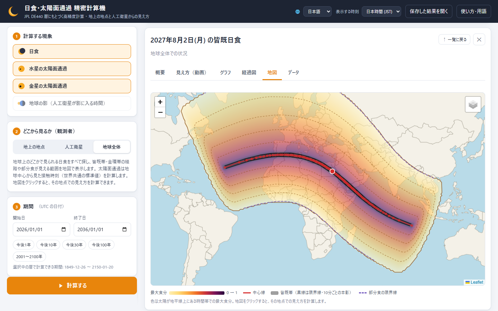
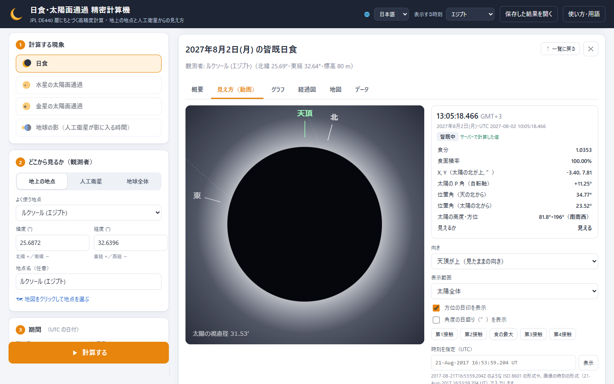
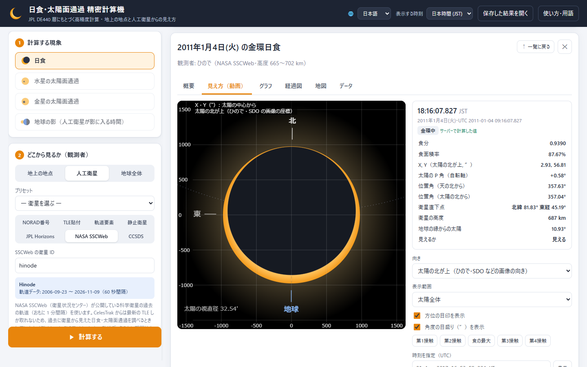
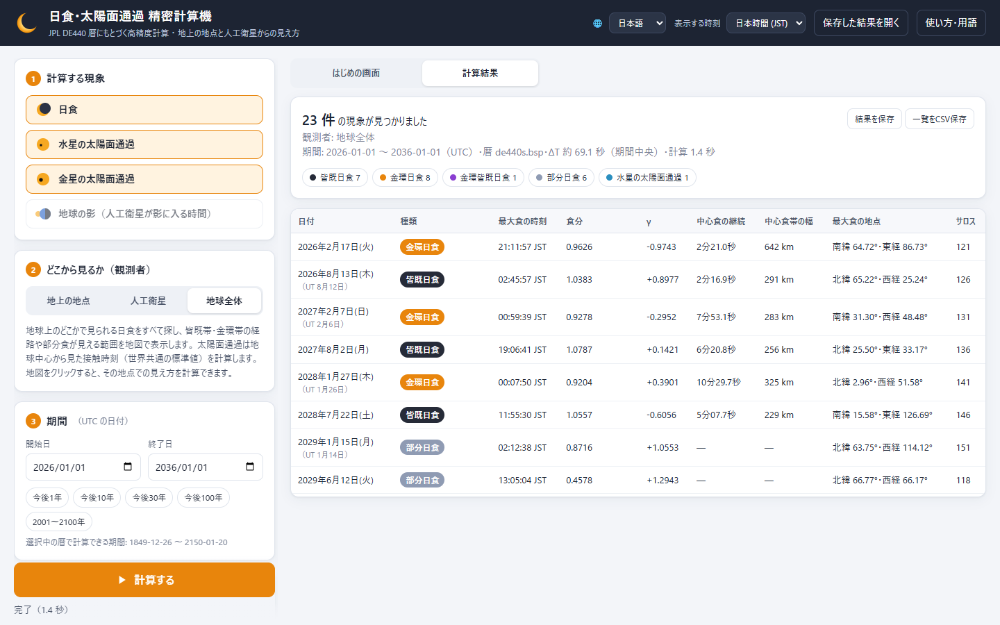
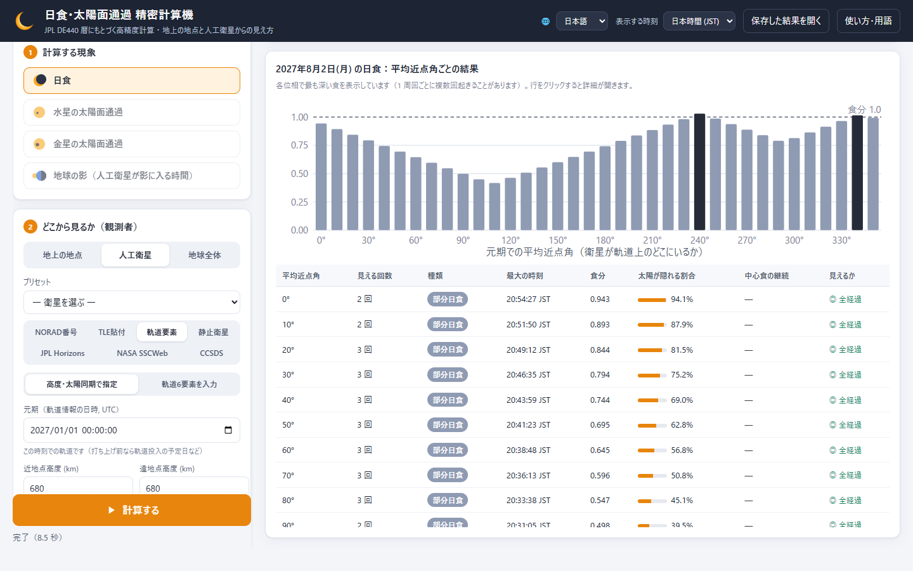
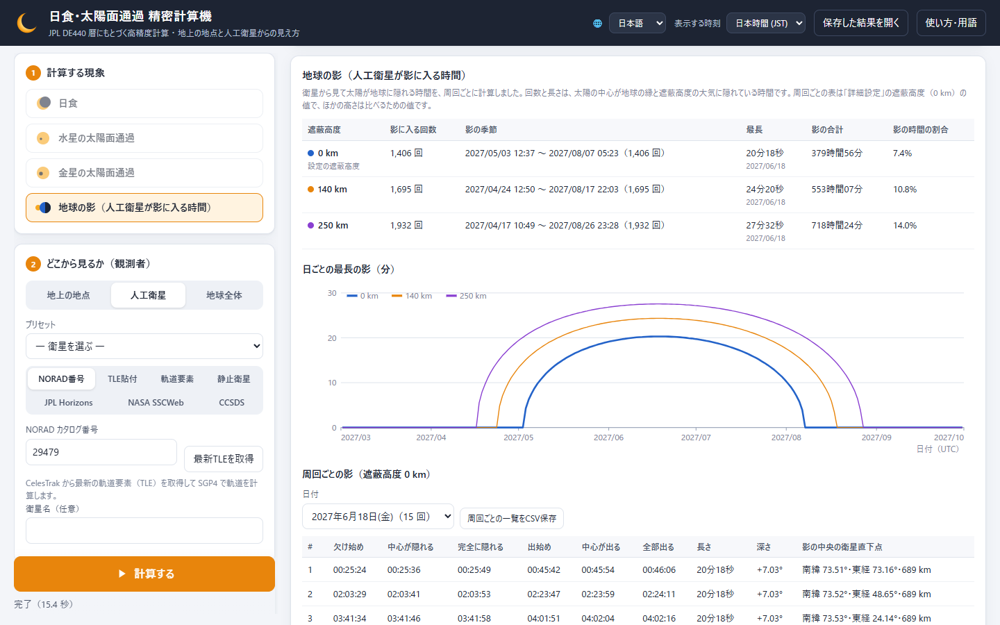

# 日食・太陽面通過 精密計算機

[English](README.md) | **日本語**

日食（月による太陽の食）と、水星・金星の太陽面通過を高精度に計算し、ブラウザで分かりやすく閲覧するツールです。
観測者は **地上の任意地点**、**人工衛星（TLE / 軌道要素 / 静止衛星 / JPL Horizons の探査機 / CCSDS の軌道データ・追跡データ）**、**地球全体** から選べます。



| | |
|---|---|
|  |  |
| **地上から見た様子**：ルクソール（エジプト）での 2027 年 8 月 2 日の皆既日食。皆既は 6 分 18.9 秒、欠け方を動画で再生できます | **人工衛星から見た様子**：太陽観測衛星「ひので」が 2011 年 1 月 4 日に軌道上で見た金環日食。太陽の北を上にし、ひので・SDO などの画像と同じ角度秒（″）の目盛りで表示 |
|  |  |
| **一覧**：2026〜2035 年に世界で起きる日食と太陽面通過（種類・食分・中心食の継続時間・サロス番号） | **打ち上げ前の検討**：高度 680 km の太陽同期軌道から見る 2027 年 8 月 2 日の日食を、衛星の位置（平均近点角）ごとに計算 |
|  | |
| **地球の影**：「ひので」が 2027 年に地球の影に入る時間。大気の遮蔽高度（可視光 0 km・軟X線 140 km・極紫外線 250 km）ごとの影の季節、日ごとの最長の影、周回ごとの入りと出 | |

## 起動

Python をインストールしていなくても使えます。

### 配布用パッケージ（ダウンロード不要）

| OS | ファイル | 中身 |
|---|---|---|
| Windows 10 / 11 | `solar_eclipse_calc-<版>-windows-x64.zip`（約 66 MB） | フォルダ（`start.bat` で起動） |
| macOS 11 以降（Apple シリコン・Intel 共通） | `solar_eclipse_calc-<版>-macos.zip`（約 120 MB） | アプリ「日食計算機」 |

Python・ライブラリ・JPL 暦（1849〜2150 年）が入っているので、初回からインターネットに接続しなくても数秒で起動します。
ブラウザで `http://127.0.0.1:8765/` が開きます（ポートが使用中の場合は、起動中の本ツールをそのまま開くか、空いているポートを自動で選びます）。
PC の設定やインストール済みの Python には影響せず、管理者権限も不要です。

**Windows**

1. ZIP を右クリック →「すべて展開」し、展開したフォルダの `start.bat` をダブルクリックします。
2. 初回に「Windows によって PC が保護されました」と表示されたら、「詳細情報」→「実行」を押します。
3. 終了するときは、ブラウザの計算機の画面（タブ）をすべて閉じます。約 10 秒後に、起動時に開いた黒い画面（コマンドプロンプト）も自動で閉じます。黒い画面を閉じても終了できます。不要になったらフォルダごと削除してください。

**Mac**

1. ZIP を Safari などのブラウザでダウンロードしてダブルクリックで展開し、「日食計算機」を「アプリケーション」フォルダにドラッグします。
2. 「日食計算機」をダブルクリックします。初回は「インターネットからダウンロードされたアプリケーションです。開いてもよろしいですか？」と表示されるので「開く」を押します。
3. 終了するときは、計算機のタブ（またはブラウザ）を閉じるか、画面右上の「終了」を押します。タブをすべて閉じると、計算機も約 10 秒後に自動で終了します。

ZIP をリモートデスクトップの「Windows App」やメッセージアプリなどから Mac に保存すると、macOS がアプリの実行を禁止し、「アプリケーション"日食計算機"を開けません」と表示されます。ブラウザでダウンロードし直してください。

追加した暦などは `~/Library/Application Support/SolarEclipseCalc`、ログは `~/Library/Logs/SolarEclipseCalc.log` に保存されます。不要になったら、アプリとこのフォルダを削除してください。
Mac 版は Apple の Developer ID で署名し、公証を受けて配布します（[作り方](docs/macos_signing.md)）。公証していない Mac 版は、初回に「"日食計算機"は開いていません」と表示されたあと、「システム設定」→「プライバシーとセキュリティ」の下にある「このまま開く」を押すと開けます。

1550〜2650 年を扱う場合は、画面の「詳細設定」にある **「de440.bsp を追加」** を押すと DE440（約 114 MB）をダウンロードし、暦として選べるようになります。
Windows で新しい版に入れ替えるときは、追加した暦（`data/de440.bsp`）を新しいフォルダの `data/` に移すとダウンロードを省けます（Mac ではそのまま引き継がれます）。

### ソース一式から起動

リポジトリの ZIP などの配布用パッケージでないフォルダでも、`start.bat`（Windows）／`start.command`（macOS、Linux は端末で `sh start.command`）で起動できます。
この場合は初回だけ、Python の実行環境（[uv](https://github.com/astral-sh/uv) と Python 3.12）、必要なライブラリ、JPL 暦をインターネットからダウンロードするため、数分かかります。2 回目以降は数秒で起動し、オフラインでも動きます。
Python 本体とライブラリはフォルダ内の `.runtime/` にだけ置かれます（約 200 MB）。

Mac でダウンロードしたソース一式は、`start.command` をダブルクリックすると「壊れているため開けません」と表示されます（署名のないスクリプトのため）。最初の 1 回だけ「ターミナル」を開いて `sh ` と入力し（sh の後に半角スペース）、`start.command` をターミナルのウィンドウにドラッグして return キーを押してください。このときフォルダから「インターネットから入手」の印を外すので、2 回目からはダブルクリックで起動できます。

### Python をお使いの場合

```bash
pip install -r requirements.txt
python run.py
```

DE440 は `python tools/download_ephemeris.py de440` でも追加できます。
`start.bat` / `start.command` で準備した Python（`.runtime/venv/`）でテストやツールを実行することもできます（例: Windows は `.runtime\venv\Scripts\python tests\test_validation.py`、Mac・Linux は `.runtime/venv/bin/python tests/test_validation.py`）。

### コマンドラインでの計算（生成 AI からの利用）

画面と同じ計算を、画面を開かずに `cli.py` で実行できます。観測者は画面と同じく、次のどれでも指定できます。
軌道情報などを生成 AI（Claude Code などのコーディングエージェント）に渡すと、AI が `cli.py` で計算・確認できるようにしてあり、手順と出力の項目を [docs/cli.md](docs/cli.md) に、AI 向けの要点を [AGENTS.md](AGENTS.md) にまとめています。

| 観測者 | 引数 |
|---|---|
| 軌道6要素 | `--epoch`（元期, UTC）`--a --e --i --raan --argp --m` |
| 計画中の軌道 | `--epoch` と `--alt`（または `--perigee-alt --apogee-alt`）、`--sso`（または `--i`）、`--ltan`（または `--raan`）。`--sweep 10` で平均近点角ごとの一括計算 |
| TLE | `--tle ファイル`（`-` で標準入力）、`--norad 番号`（CelesTrak から最新の TLE を取得）。元期から何週間も先なら `--sweep 10` で衛星の位置による幅を確認 |
| 静止衛星・探査機・過去の軌道 | `--geo-lon 経度`、`--horizons ID`（JPL Horizons）、`--sscweb ID`（NASA SSCWeb） |
| CCSDS のメッセージ | `--ccsds ファイル`（OEM・OPM・OMM・OCM・TDM。KVN・XML。TDM には観測局の位置 `--station 名前=緯度,経度,標高` を添える） |
| 地上の地点・地球全体 | `--lat --lon --elev`、`--city 地点名`、`--global` |
| JSON | `--request ファイル`（Web API と同じ形） |

```bash
python cli.py --epoch 2027-07-30T12:00:00 --a 7058.1 --e 0.0012 --i 98.13 --raan 220.5 --argp 90 --m 45 --start 2027-07-25 --end 2027-08-10 --tz 9
```

```bash
python cli.py --city 東京 --start 2026-01-01 --end 2056-01-01 --phenomena moon --tz 9 --detail
```

期間は `--start` `--end`（UTC の日付）、現象は `--phenomena`（`moon`, `mercury`, `venus`。既定はこの 3 つ）で指定します。`earth` で、衛星が地球の影に入る時間を計算します（下記）。

```bash
python cli.py --norad 29479 --phenomena earth --start 2027-03-01 --end 2027-10-01 --tz 9
```

出力は `--format table`（既定。`--tz 9` で日本時間）、`csv`（画面の「一覧をCSV保存」と同じ列）、`json`（計算条件 `request` つき。生成 AI 向け）から選べ、`--detail` で接触ごとの時刻・太陽高度・位置角なども出力します。`--dry-run` は計算せずに入力の解釈（衛星の周期・高度など）だけを出力します。
表示の言語は `--lang`（`ja`, `en`, `fr`, `ru`, `es`, `zh`, `hi`）で選べます（既定は環境の言語）。
ほかの引数は `python cli.py --help` で確認できます。
Python をインストールしていない場合は、Windows の配布用パッケージなら `.runtime\python-windows-x86_64\python.exe -E -s cli.py …`、ソース一式を `start.bat` / `start.command` で準備した場合は `.runtime/venv/` の Python で実行します。
ファイルやパイプへの出力は UTF-8 です。Windows PowerShell 5.1 で出力を受け取って文字化けするときは、`-o ファイル` で保存してください。

### 配布用パッケージの作り方

```bash
python tools/build_bundles.py
```

`dist/` に Windows 用と macOS 用の ZIP ができます（数分。Windows でも Mac 用を作れます）。[uv](https://github.com/astral-sh/uv) と git が必要です。
中身は git で管理しているファイル（`git add` 済みのもの）、`data/de440s.bsp`、Python 3.12（[python-build-standalone](https://github.com/astral-sh/python-build-standalone)。バージョンとチェックサムはスクリプトに固定）と、`requirements.txt` を満たす作成時点のライブラリです。
ライブラリのバイトコードはあらかじめコンパイルしてあり、初回の起動も速くなっています。Linux 用は `--target linux-x86_64` で作れます。

Mac 版を Developer ID で署名して公証するには `--sign` に設定ファイルを指定します。証明書と API キーの用意から順に [docs/macos_signing.md](docs/macos_signing.md) にまとめています。

```bash
python tools/build_bundles.py --target macos --sign <署名用フォルダ>/signing.json
```

### Cloudflare で公開する（インストール不要）

画面を [Cloudflare Containers](https://developers.cloudflare.com/containers/) で動かすと、PC にインストールしなくても URL を開くだけで使えます（Workers Paid プランが必要）。
リポジトリの Secrets に Cloudflare の API トークンとアカウント ID を登録すると、GitHub Actions が公開し、`main` への push のたびに公開し直します。手順と料金の目安は [docs/cloudflare.md](docs/cloudflare.md) にあります。
`Dockerfile` は Docker が動くほかの場所でも使えます（`docker build -t eclipsecalc .` → `docker run --rm -p 8080:8080 eclipsecalc`）。

## できること

| 観測者 | 内容 |
|---|---|
| 地上の地点 | 緯度・経度・標高（WGS84）。都市プリセット、地図クリックでの地点選択。地平線・大気差・最低太陽高度を考慮 |
| 人工衛星 | NORAD 番号で CelesTrak から最新 TLE を取得（SGP4）／TLE 貼り付け／ケプラー軌道要素（J2 永年摂動つき。軌道6要素〔元期・軌道長半径・離心率・傾斜角・昇交点赤経・近地点引数・平均近点角〕の直接入力のほか、高度での指定、太陽同期軌道の傾斜角の自動計算、昇交点の地方時での指定に対応）／理想静止衛星／JPL Horizons の任意探査機（JWST、SOHO 等）／NASA SSCWeb の科学衛星の過去軌道（「ひので」等。過去の現象の再現用）／**CCSDS の軌道データメッセージ**（JAXA などの宇宙機関が軌道の受け渡しに使う国際標準。OEM は補間、OPM・OCM の状態ベクトルは数値積分〔地球の重力場・太陽と月・大気抵抗・太陽輻射圧・軌道制御〕、OMM は SGP4）と**追跡データメッセージ（TDM）**（観測局の位置を添えると、角度・距離・ドップラーの観測から軌道を決めて計算）。**地球による太陽の遮蔽**（大気高度も指定可）を考慮し、**衛星が地球の影に入る時間**も計算（現象の「地球の影」: 影の季節と、周回ごとに太陽の一部・中心・全体が隠れる時刻と長さを、大気の遮蔽高度ごとに比べて表示） |
| 地球全体 | 世界のどこかで見える日食を全探索（種類・γ・食分・最大食地点・中心食継続時間・中心食帯幅・サロス番号）。太陽面通過は地心接触時刻 |

結果画面（上の「はじめの画面」「計算結果」で、ようこそ画面と計算結果を行き来できます。詳細の「↑ 一覧に戻る」で一覧へ戻ります）:

- **一覧**: 日付・種類・最大時刻・食分/中心間距離・継続時間・見えるか（日の出/日の入り帯食、地球による遮蔽）・サロス。種類フィルタ、CSV 保存。**「結果を保存」で一覧と計算条件を保存し、右上の「保存した結果を開く」であとから同じ画面で見返せます**（一覧は保存したときのまま表示し、行をクリックすると保存した条件で詳細・動画・地図を計算し直します。`cli.py --format json` の出力も開けます）
- **概要**: 平易な日本語の説明文、主要指標、第1〜第4接触の時刻・太陽高度/方位・位置角（天の北から／太陽の北から）・天頂角 V・衛星直下点、太陽の北が上の X, Y（″）と太陽の縁からの距離、**半径による接触時刻の変化**（太陽・月/惑星の視半径が 1″ 大きいと何秒動くか）、衛星から太陽が見えている時間帯の表
- **見え方（動画）**: 太陽と月/惑星の円盤を実スケールで再生（天頂が上／天の北が上／地球方向が下／**太陽の北が上**＝ひので・SDO などの画像の向き）。角度の目盛り（″）と拡大（太陽全体〜30″ 四方。水星の太陽面通過の入り・出も見えます）。地平線、衛星から見た地球の縁、皆既中のコロナも表示
- **時刻を指定・観測画像と比べる**: 画像の撮影時刻（`21-Aug-2017 16:53:59.204 UT` のような形も可）を入れると、その瞬間の月/惑星の位置（太陽の北が上の X, Y）・縁からの距離・食分をミリ秒の時刻で計算します。測った位置を添えると観測 − 計算（″ と、運動方向の時刻のずれ）を表にし、露光時間を入れれば露光の中央で比べます（`cli.py --at` も同じ）
- **地球の影**（人工衛星）: 遮蔽高度（既定 0・140・250 km と「詳細設定」の値）ごとの影の季節、日ごとの最長の影のグラフ、選んだ日の周回ごとの表（太陽が欠け始める・中心が隠れる・完全に隠れる時刻とその逆、長さ、深さ、衛星直下点）。「結果を保存」で保存でき、周回ごとの一覧は CSV に保存できます
- **グラフ**: 食分・食面積率（通過は中心間距離）、太陽高度または「地球の縁からの太陽の離角」
- **経過図**: 太陽面上の月/惑星の経路、第1接触・最大・第4接触の円、接触の時刻と位置（太陽中心からの角度秒）、主な値を 1 枚にまとめた図（天の北が上／太陽の自転軸の北が上。PNG・SVG で保存）
- **地図**: 中心線、皆既/金環帯の南北限界線、10 分ごとの本影、部分食の限界線、最大食分の分布（太陽が地平線上の時間帯のみ）、太陽面通過の可視地域、衛星直下点軌跡。**地図をクリックするとその地点の見え方を計算**
- **データ**: JSON（「保存した結果を開く」で開き直せます）・時系列 CSV・テキスト

表示時刻のタイムゾーンは右上で切り替えられます（計算は UTC/TT で行い、表示のみ変換）。

画面の言語は右上の 🌐 で、日本語・English・Français・Русский・Español・中文・हिन्दी から選べます（初回はブラウザの言語に合わせ、選んだ言語は次回も使います）。エラーや注意のメッセージも選んだ言語で表示します。`cli.py` の出力も `--lang` で同じ言語から選べます。文書は日本語です。

### 打ち上げ前の衛星

日食が起きる日は何年も前から決まっていますが、衛星から見た時刻や欠け方は「その瞬間に衛星が軌道上のどこにいるか」で大きく変わり、これは打ち上げて軌道が決まるまで分かりません。
「軌道要素」に計画値（高度、太陽同期軌道なら昇交点の地方時）を入れ、**「平均近点角を変えて一括計算」** を選ぶと、衛星の位置を 5〜45° 刻みで変えて計算し、現象ごとに次の範囲をまとめます。

- 衛星から見えるか、1 回の日食で何回遭遇するか（低軌道では周回ごとに繰り返し遭遇します）
- 最大食分の範囲と、皆既・金環になる位相の割合
- 最大の時刻の範囲（位相ごとの結果の表・グラフから、各ケースの詳細も開けます）

例: 高度 680 km・昇交点 18 時の太陽同期軌道から見る 2027-08-02 の皆既日食は、どの位相でも 2〜3 回の部分日食になりますが、最大食分は 0.42〜1.03 と位相で大きく変わり、皆既になるのは 36 通り中 2 通りです。
打ち上げ後は NORAD 番号で最新の TLE を取得して計算し直し、現象の数日前にもう一度計算すると秒単位の時刻になります（[「ひので」での検証](docs/hinode_validation.md)では、2〜4 週間前の軌道要素で 1〜19 秒、直前の軌道で 1〜2 秒程度の差でした）。

## 精度と検証

NASA（Espenak & Meeus）の公表値との比較（`python tests/test_validation.py` で再現できます）。
接触時刻の比較では NASA と同じ半径（太陽 959.63″、金星 8.41″・水星 3.36″ at 1 AU）を使用しています。本ツールの既定は実際に見える縁・円盤の半径（太陽 959.96″、金星 6,131 km。下記）で、太陽面通過の接触は NASA の値と数秒違います。

| 現象 | 項目 | NASA 公表値 | 本ツール |
|---|---|---|---|
| 2012 金星の太陽面通過（地心） | 第1〜第4接触 | 22:09:38 / 22:27:34 / 01:29:36 / 04:31:39 / 04:49:35 | 22:09:37.5 / 22:27:34.0 / 01:29:36.7 / 04:31:39.1 / 04:49:35.7 |
| 2004 金星の太陽面通過（地心） | 第1〜第4接触 | 05:13:29 / 05:32:55 / 08:19:44 / 11:06:33 / 11:25:59 | 05:13:30.0 / 05:32:55.8 / 08:19:44.7 / 11:06:33.4 / 11:25:59.3 |
| 2019 水星の太陽面通過（地心） | 第1〜第4接触・最小距離 | 12:35:27 / 12:37:08 / 15:19:48 / 18:02:33 / 18:04:14・75.9″ | 12:35:27.2 / 12:37:08.4 / 15:19:48.1 / 18:02:33.0 / 18:04:14.3・75.9″ |
| 2017-08-21 皆既日食 | γ・食分・継続・幅 | 0.4367・1.0306・2分40秒・115 km | 0.4367・1.0306・2分40.0秒・114.7 km |
| 2024-04-08 皆既日食 | γ・食分・継続・幅 | 0.3431・1.0566・4分28秒・197.5 km | 0.3431・1.0566・4分28.0秒・197.5 km |
| 2023-04-20 金環皆既日食 | 食分・継続 | 1.0132・1分16秒 | 1.0132・1分16.0秒 |
| 2023-10-14 金環日食 | 食分・継続 | 0.9520・5分17秒 | 0.9520・5分17.1秒 |
| 2001〜2100 年の日食 | 件数 | 部分77・金環72・皆既68・金環皆既7 | 同数 |

さらに、地図用の「影の円錐」モデルで求めた皆既帯の限界線を、独立した地点計算（Skyfield による地上観測者の視位置）で検証しています。限界線の 100 m 外側は部分日食、100 m 内側は皆既日食になることを確認しています。

CCSDS のメッセージは `python tests/test_ccsds.py` で確かめています。TLE から作った OMM は TLE と 1 m 以内で同じ位置になり、TLE の位置を 1 分ごとに書いた OEM は TLE と同じ日食の時刻（差は 2 ms 未満）を与えます。OPM の数値積分は国際宇宙ステーション（2008 年）で SGP4 と 1 日で 3 km 以内、軌道制御の前後の軌道長半径の変化は vis-viva の式どおりです。TDM は、既知の軌道から作った角度・距離・ドップラーの観測から、その軌道を 36 時間にわたって 2 m 以内（雑音なし）で復元し、雑音を加えた観測では残差が加えた雑音の大きさになります。

### 太陽観測衛星「ひので」の実観測との比較

「ひので」（高度約 680 km）が 2006〜2026 年に軌道上で遭遇した日食・太陽面通過を、NASA SSCWeb の過去軌道を使って計算し、実際の観測画像（特に、各コマに撮影時刻がミリ秒まで入った[国立天文台ひので科学センターの QL 動画](https://hinode.nao.ac.jp/en/for-researchers/qlmovies/)）と国立天文台の予報に照らしました（`python tests/test_hinode.py`、QL 動画の測定は `python tools/validate_hinode_ql.py`（ffmpeg が必要）、広報画像の測定は `python tools/validate_hinode_images.py`。詳細は [docs/hinode_validation.md](docs/hinode_validation.md)）。

| 比較対象 | 結果 |
|---|---|
| SOT G バンドの QL 動画（6.4 秒ごと）で測った 2006 年の水星の太陽面通過の接触時刻 | 観測 19:12:25.7 / 19:14:25.6 / 00:08:01.5 / 00:10:00.2 UT。本ツール（既定の半径）との差は +0.1 / +1.3 / +1.2 / +0.5 秒。動画に合う太陽の縁の半径は 1 AU で 959.96″ で、これを既定にしました（以前の既定の IAU 2015 公称値 959.23″（光球 τ=1）では 8〜10 秒ずれていました） |
| XRT の QL 動画に写った月の位置（2007〜2026 年、31 現象・55 パス・2,626 コマ） | 実際の現象との差は、露光の短い動画で現象ごとに −1.45〜+2.34 秒（22 現象の平均 +0.44 秒、ばらつき 0.91 秒 ≒ 沿軌道 7 km）。露光の長いフィルターでは +0.7〜+3.0 秒（題名の時刻が露光の開始のため）。食分の差は 0.004 以内（2017 年以降）。1 日の食の回数と時刻、軌道上でだけ起きた 2007-02-17 と 2025-02-28 の食、地球の影の中のパスも計算どおり |
| X 線望遠鏡の広報画像に写った月の位置（2014・2016・2017 年） | 実際の現象との差 0.4〜3.5 秒（軌道の沿軌道誤差 3〜28 km 相当）。画像の回転角は太陽の自転軸方位角と 0.4° 以内で一致 |
| 国立天文台（相馬充氏）の予報 8 現象・20 パス | 現象ごとにほぼ一定の差（軌道要素の違い）。それを除いた残差は RMS 0.2〜0.65 秒 |
| 観測報告 11 現象（食分、画像の時刻、軌道上でだけ起きた食、金星の第1接触が地球の影に入ったこと等） | すべて整合 |

低軌道衛星からの食の計算精度は、ほぼ衛星の軌道の精度で決まります（沿軌道 7.5 km ≒ 1 秒）。太陽面通過では軌道の影響は小さく（沿軌道 1 秒で接触 0.05 秒）、太陽の半径の値が接触時刻を左右します（1″ あたり水星で 10〜12 秒、金星で 13〜19 秒）。

### 計算方法の要点

- **天体位置**: JPL DE440/DE440s（Skyfield）。観測者ごとに光行時間を反復計算（10⁻¹² 日まで収束）
- **時刻系**: IERS 観測値と長期モデルによる ΔT（手動指定も可）、閏秒を含む UTC
- **接触判定**: 観測者から見た太陽と月（惑星）の視半径・中心間角距離。光行差は全方向に共形写像として作用し接触（円の接線条件）を変えないため、BCRS 方向（天体位置）で判定し、高度・方位・位置角は視位置で計算
- **探索**: 地心合（新月・内合）で候補時間帯を絞り込み、観測者の最大視差を考慮して窓幅を決定。両天体の実際の角速度から求めたリプシッツ定数による分枝限定法で、短い食（低軌道衛星では数分）も取りこぼさないよう走査し、接触は二分法で 0.1 ms、最大は黄金分割で収束
- **地球全体の食**: 太陽・月の地心視位置を ITRS（地球固定座標）に変換し、太陽と月に接する半影・本影円錐と WGS84 楕円体の交差を直接計算（ベッセル要素と等価）。限界線は影の輪郭の包絡線（輪郭上で境界の時間微分が 0 になる点）として求めます
- **太陽・惑星の半径**: 接触は実際に見える縁（周辺減光の変曲点）で起き、これは IAU 2015 公称値が表す光球 τ=1 より約 0.33 Mm 外側です。既定は見える縁の 1 AU で 959.96″（696,231 km）で、「ひので」SOT の 2006 年の水星の太陽面通過の動画から求め、他の測定（SDO/HMI 959.90″、日食の光度曲線 959.99″、SOHO/MDI 960.12″）とも合います。金星は太陽の前では固体表面より大きく見え、既定は可視光の円盤 6,131 km（雲頂ともや）、X 線では 6,202 km です（Reale et al. 2015）。NASA の値（959.63″・8.41″・3.36″）、IAU の値、任意の値も選べ、接触ごとに半径が 1″ 大きいと何秒動くかを表示します
- **月の半径**: NASA 方式（外接 k=0.2725076、内接 k=0.272281）で月縁の山・谷の平均的な影響を近似。平均半径・任意値も選択可
- **衛星**: SGP4（TLE）、2 体＋J2 永年摂動（軌道要素）、地球固定点（静止衛星）、Horizons の位置・速度のエルミート補間。地球の遮蔽は WGS84 楕円体の縁の局所半径（緯度はその日の地球の極から）＋指定した大気高度で、太陽の方向は地球の座標系での方向（地球の速度による光行差を加えたもの）で判定。Horizons の表は補間の誤差が 10 m 以下になる刻みで取得（地球や月に近い軌道・フライバイで粗い刻みを指定したときは細かくして注意を表示）
- **CCSDS**: OEM は Hermite・Lagrange 補間。OPM・OCM の状態と TDM で決めた軌道は、変形 Chebyshev–Picard 反復による数値積分（EGM96 の 8 次までの重力場、DE440 の太陽と月、指数関数モデルの大気抵抗、地球の影を含む太陽輻射圧、瞬時の軌道制御）。TDM の軌道決定は光の伝わる時間を含む観測モデルの重み付きバッチ最小二乗（4σ を超える観測を除外、往復の全長で書かれた距離は自動で半分に）

### 制限事項

- 月縁の地形（凹凸）は考慮していないため、実際の接触時刻は地上で ±1〜3 秒程度（特に皆既の始まり・終わり）、低軌道の衛星から見た食で ±0.1〜0.4 秒ずれることがあります。
- 将来・過去の ΔT は不確かです。時刻そのものよりも「食が見える場所（経度）」に影響します。
- TLE は元期から日数が経つと位置誤差が大きくなります（画面に警告を表示します）。数か月以上先の衛星からの予報は目安としてください。CelesTrak からは最新の TLE しか取得できないため、過去の現象を衛星から計算するときは当時の TLE を貼り付けるか、「NASA SSCWeb」（衛星 ID で指定。例: hinode）を使ってください。
- CCSDS の OPM・OCM・TDM から伝搬するときの大気の密度は平均的な太陽活動の値です。低軌道では太陽活動によって数日で数 km の差が出ることがあるため、精度が必要なときは運用機関の OEM（軌道暦）を使ってください。TDM の周波数・位相の観測と、メッセージの共分散は使いません。
- 大気差は太陽高度の表示と「見えるか」の判定に使い、円盤の変形は描画していません（接触時刻には影響しません）。
- 初回の Python 環境の準備と暦ダウンロード、CelesTrak・JPL Horizons・NASA SSCWeb の利用、地図の「詳細地図」にはインターネット接続が必要です。その他（CCSDS のメッセージも）はオフラインで動作します。

## ファイル構成

```
start.bat / start.command   起動ファイル（Windows / Linux・Mac のソース一式）。同梱の Python で起動し、なければ初回に .runtime/ へ自動で準備
run.py                      起動スクリプト（Python から直接起動する場合）
eclipsecalc/
  context.py                暦・時刻系の読み込み（暦の自動ダウンロード）
  net.py                    HTTPS 通信（OS の証明書ストアで検証）
  observers.py              観測者モデル（地上・TLE・軌道要素・静止・Horizons・SSCWeb・CCSDS）
  ccsds.py                  CCSDS の軌道データメッセージ（OEM・OPM・OMM・OCM）と追跡データメッセージ（TDM）の読み取り
  propagate.py              軌道の数値積分（重力場・太陽と月・大気抵抗・太陽輻射圧・軌道制御）
  od.py                     TDM の観測からの軌道決定
  conjunctions.py           新月・内合の探索（候補時間帯）
  local.py                  観測者ごとの接触時刻・最大・可視性の計算
  shadow.py                 ITRS での半影/本影円錐
  global_eclipse.py         地球全体の日食探索
  earth_shadow.py           人工衛星が地球の影に入る時間（季節と周回ごと）
  eclipse_map.py            中心線・限界線・食分分布・通過可視図
  server.py                 Web API（FastAPI）
  i18n.py                   Web API のエラー・注意の翻訳
static/                     画面（HTML/CSS/JavaScript、Leaflet、Natural Earth 地図）
  i18n.js                   画面の翻訳（日本語の文言をキーに 6 言語）
tests/test_validation.py    NASA 公表値との比較テスト
tests/test_hinode.py        「ひので」の予報・観測報告との比較テスト
tests/test_orbit_planning.py  太陽同期軌道・昇交点地方時・位相の一括計算のテスト
tests/test_saved_result.py  保存した結果を開いたときの詳細の再計算のテスト
tests/test_geometry.py      太陽の北が上の座標・接触時刻の感度・画像の時刻・地球による太陽の遮蔽のテスト
tests/test_ui_i18n.py       画面の文言の 6 言語の訳の漏れのテスト
tests/test_earth_shadow.py  地球の影のテスト（日食の「見えるか」との一致、影の見落としがないこと、静止衛星の季節）
tests/test_ccsds.py         CCSDS のメッセージの読み取り・軌道の伝搬・軌道決定のテスト
tools/hinode_ql.py          「ひので」の QL 動画の読み取り（コマ・撮影時刻・座標軸を文字認識で読む。ffmpeg が必要）
tools/validate_hinode_ql.py 「ひので」の QL 動画での検証
tools/validate_hinode_images.py  「ひので」の広報画像での検証
tools/build_bundles.py      Python・ライブラリ・暦を同梱した配布用 ZIP の作成
packaging/macos/            Mac 版アプリの起動部分（launcher.c・launch.sh）と署名設定の見本
Dockerfile                  画面のコンテナ（Python・ライブラリ・暦 de440s と de440 を同梱）
cloudflare/                 Cloudflare Containers で公開する Worker と設定
.github/workflows/deploy-cloudflare.yml  Cloudflare への公開（GitHub Actions）
docs/cloudflare.md          Cloudflare で公開する手順
docs/hinode_validation.md   「ひので」による検証の記録
docs/macos_signing.md       Mac 版の署名と公証の手順
docs/images/                README の画面例（en/ は英語版の README 用）
data/                       JPL 暦（初回起動時に自動取得、git 管理外）
.runtime/                   Python・ライブラリ（配布用パッケージに同梱、またはソース一式では初回に準備。git 管理外）
build/ dist/                配布用 ZIP の作業場所と出力先（git 管理外）
```

### API（抜粋）

- `POST /api/search` … `{"phenomena": ["moon","mercury","venus"], "observer": {...}, "start": "2026-01-01", "end": "2036-01-01", "settings": {...}}`
  - observer 例: `{"type":"ground","lat":35.68,"lon":139.77,"elevation_m":40}`, `{"type":"celestrak","norad":25544}`, `{"type":"geo","lon":140.7}`, `{"type":"horizons","command":"-170","step_min":60}`, `{"type":"sscweb","id":"hinode"}`, `{"type":"ccsds","text":"CCSDS_OPM_VERS = 3.0 …"}`, `{"type":"global"}`
  - 軌道要素（`kepler`）では `"sso": true`（傾斜角を自動計算）、`"ltan_h": 18.0`（昇交点の地方時で軌道面を指定）も使えます
  - 現象に `"earth"`（人工衛星のみ）を加えると、衛星が地球の影に入る時間 `earth_shadow` を返します（遮蔽高度は `settings.earth_atm_km` と比べる高さ `settings.shadow_atm_levels_km`。既定 `[0, 140, 250]`）
- `POST /api/phase_sweep` … `/api/search` と同じ形式に `"step_deg": 10` を加え、`kepler`・`tle`（OMM・TLE だけの `ccsds` も）の衛星の平均近点角を変えて一括計算（期間 1 年以内）
- `POST /api/ccsds/inspect` … `{"text": "CCSDS のメッセージ", "object": "…", "stations": "…"}` で、メッセージの内容・天体・TDM の参加者と、観測者の解釈を返す（画面の「内容を確認」）
- `POST /api/ephemeris/download?name=de440.bsp` … JPL 暦を `data/` にダウンロード（画面の「de440.bsp を追加」）
- `POST /api/shutdown` … 計算機を終了（Mac 版アプリの「終了」。`run.py --app` で起動したときだけ有効）
- `GET /api/page/stream` … 画面が開いている間つなぎ続けるイベントストリーム。`run.py` がブラウザを開いて起動したときは、これがすべて切れて 10 秒たつと終了します（`--no-browser` では終了しません）
- `GET /api/event/{id}` … 接触時刻と時系列、`GET /api/event/{id}/map` … 地図データ、`POST /api/local` … 地図上の地点の見え方

`http://127.0.0.1:8765/docs` で対話的な API ドキュメントを参照できます。

## データとライブラリ

JPL DE440 暦・JPL Horizons（NASA/JPL）、CelesTrak（TLE）、NASA SSCWeb（衛星の過去軌道）、EGM96 重力場モデル（NASA・NGA。8 次までの係数）、CCSDS 502.0-B-3（軌道データメッセージ）・503.0-B-2（追跡データメッセージ）、Skyfield（MIT）、sgp4（MIT）、Leaflet（BSD-2）、Natural Earth（パブリックドメイン）、OpenStreetMap（ODbL、詳細地図表示時）。

## ライセンス

[MIT License](LICENSE)。同梱の Leaflet は BSD-2-Clause（[static/vendor/leaflet/LICENSE](static/vendor/leaflet/LICENSE)）です。
