# 「ひので」の実観測による精度検証

太陽観測衛星「ひので」（SOLAR-B、NORAD 29479、高度約 680 km の太陽同期極軌道）が 2006〜2026 年に軌道上で遭遇した日食・太陽面通過を使って、本ツールの計算を検証した記録です。

- 再現: `python tests/test_hinode.py`（予報値・観測報告・QL 動画で測った接触時刻との比較、約 30 秒）、`python tools/validate_hinode_ql.py`（QL 動画の測定、約 5 分・動画約 25 MB を取得。ffmpeg が必要）、`python tools/validate_hinode_images.py`（広報画像の測定、約 2 分・画像約 10 MB を取得）、`python tools/hinode_ql_figures.py`（付録の画像）
- 「ひので」の軌道: NASA SSCWeb（Satellite Situation Center）の過去軌道（60 秒間隔）。画面の「人工衛星 → NASA SSCWeb」（API では `{"type":"sscweb","id":"hinode"}`）として追加しました。現在の CelesTrak TLE を SGP4 で計算した位置と元期付近で約 1 km（沿軌道 0.1 秒相当）で一致しており、TLE 相当の精度の軌道です（SSCWeb は SGP4 の TEME を章動なしの平均赤道とみなして J2000 に変換しており、0.2〜0.4 km・接触で 0.05 秒以下の差があります）。
- 観測データ: 国立天文台ひので科学センターの [QL 動画アーカイブ](https://hinode.nao.ac.jp/en/for-researchers/qlmovies/)（2006〜2026 年の日ごとの XRT 全面画像・XRT/SOT 動画。各コマに撮影時刻がミリ秒まで、太陽の北が上の角度秒の座標軸が描かれています）と、ひのでチーム・宇宙科学研究所の広報画像。
- 比較に使った動画・コマ（パスごとに 1 枚、計算の月の縁を重ねたもの）と広報画像の URL は[付録](#付録-比較に使った観測画像)にまとめました。

## 結論

| 検証 | 結果 |
|---|---|
| **QL 動画（SOT G バンド）で測った 2006 年の水星の太陽面通過の接触時刻** | 本ツールの既定（太陽半径 = 見える縁 959.96″）との差は **+0.1 / +1.3 / +1.2 / +0.5 秒**（第1〜第4接触）。以前の既定（IAU 2015 公称値 695,700 km）では −8.8 / −7.6 / +10.1 / +9.4 秒ずれていたため、既定の太陽半径をこの測定に合わせて変更 |
| **QL 動画（XRT）に写った月の位置（2007〜2026 年、31 現象・55 パス・2,626 コマ）** | 計算と実際の現象の差（軌道の時刻ずれ）は、露光の短い動画で現象ごとに **−1.45〜+2.34 秒**（22 現象の平均 +0.44 秒、ばらつき 0.91 秒 ≒ 7 km）。露光の長いフィルター（Ti poly・Be thin）では +0.7〜+3.0 秒と大きめ（題名の時刻が露光の開始のため）。食分の差は最大 0.004（2017 年以降で測定）、1 日の食の回数と時刻、軌道上でだけ起きた 2007-02-17 と 2025-02-28 の食、地球の影の中のパスも計算どおり |
| 広報画像（XRT）に写った月の位置（2014・2016・2017 年） | 本ツールの計算と実際の現象の差は **0.4〜3.5 秒**（軌道の沿軌道誤差 3〜28 km 相当）。画像の回転角は太陽の自転軸方位角 P と 0.4° 以内で一致 |
| 国立天文台・相馬充氏の予報（8 現象・20 パス） | 1 現象ごとにほぼ一定の差（+0.1〜−5.3 秒、2016 年のみ −17 秒）。この一定差（軌道の違い）を除くと残差は **RMS 0.2〜0.65 秒**（2016 年 2.3 秒） |
| 観測報告（食分・画像時刻・地球の影など 11 現象） | すべて整合。食分は ±0.005 程度で一致（予報値しかない 2016 年を除く） |

- 計算の幾何（低軌道からの視差、1 周回ごとに繰り返す複数回の食、軌道上でだけ起きる食、金環・皆既の判定、地球による遮蔽）は、独立な予報・実画像の両方と 1 秒程度で一致しました。
- 日食の誤差の大部分は**衛星の軌道**から来ます（沿軌道 7.5 km ≒ 1 秒）。相馬氏の予報は 2〜4 週間前の軌道要素によるもので、大気抵抗による沿軌道のずれから、実際より 1〜19 秒遅い予報になっていました（QL 動画・実画像の測定で確認）。本ツールでも、事前の予報では TLE の元期からの日数に応じて同様の誤差が入ります。
- 太陽面通過では軌道の影響は小さく（沿軌道 1 秒の誤差が接触で 0.05 秒）、**太陽の半径をどの値にするか**で接触時刻が 10 秒近く変わります。接触は見える縁（周辺減光の変曲点）で起きるので、光球 τ=1 の半径である IAU 2015 公称値ではなく、見える縁の半径を既定にしました（[5. 太陽と惑星の半径](#5-太陽と惑星の半径)）。

## 1. QL 動画による検証（tools/validate_hinode_ql.py、tools/hinode_ql.py）

QL 動画は表示用の 8 ビット MPEG-1 で、撮影時刻と座標はコマに描かれた文字としてしか入っていません。`tools/hinode_ql.py` は日ページの一覧・取得・キャッシュ、ffmpeg によるコマの取り出し、題名の時刻（ミリ秒）と軸の目盛の文字認識（IDL のフォントの字形との照合）を行います。130 本・837 コマ（2006〜2026 年、SOT 640×480・XRT 480×480・全面画像 512×512）で全コマの時刻を読み取り、時刻は単調に増え、最初と最後のコマはファイル名の時刻と秒まで一致しました（目視でも 61 コマを確認）。読めない字があるコマは推測せず捨てます。

### 1.1 2006-11-08 水星の太陽面通過（SOT/FG G バンド、6.4 秒ごと）

太陽への入り（19:10:32〜19:17:01、62 コマ）と出（00:04:31〜00:12:04、72 コマ）の動画で、各コマの太陽の縁（周辺減光の変曲点）と水星の影の円を当てはめ、水星の中心が縁から何″内側にあるか（d）を測りました。d が水星の半径の −1 倍・+1 倍になる時刻が外接・内接の接触です（縮尺の誤差は打ち消し合います）。

| 接触 | 観測（QL 動画） | 計算: 見える縁 959.96″（既定） | NASA 959.63″ | IAU 2015 公称値 959.23″（以前の既定） |
|---|---|---|---|---|
| 第1接触 | 19:12:25.7 ±1 | 19:12:25.6（+0.1 秒） | 19:12:29.6（−3.9） | 19:12:34.5（−8.8） |
| 第2接触 | 19:14:25.6 ±0.4 | 19:14:24.3（+1.3） | 19:14:28.3（−2.7） | 19:14:33.1（−7.6） |
| 第3接触 | 00:08:01.5 ±0.4 | 00:08:00.3（+1.2） | 00:07:56.3（+5.2） | 00:07:51.4（+10.1） |
| 第4接触 | 00:10:00.2 ±1 | 00:09:59.7（+0.5） | 00:09:55.7（+4.5） | 00:09:50.8（+9.4） |

（括弧内は観測 − 計算）

- 87 コマの d に太陽半径と時刻のずれを当てはめると、G バンドで見える縁の半径は **696,232 km（1 AU で 959.96″）**、統計誤差 ±3 km、手法による幅 ±25 km、表示用の画像処理を含めて ±0.1″ 程度でした。他の観測（SDO/HMI の 2012 年金星の太陽面通過 959.90″、日食の光度曲線 959.99″、SOHO/MDI の水星の太陽面通過 960.12″、PICARD/SODISM 959.86″）とも一致します。
- 同時に求めた時刻のずれは −1.1 秒（観測が遅い）で、東西の縁の見え方の差（0.1″ で 1.2 秒）による系統誤差の範囲です。軌道を 10 秒（75 km）ずらしても接触は 0.5 秒しか動かず、この検証は軌道によらず太陽の半径・暦・時刻を確かめるものになっています。
- 水星の半径は 4.980″ / 4.970″（計算 4.982″ / 4.978″、2439.4 km）で 0.1% で一致しました。なお 2006 年の SOT の QL 動画の座標軸は縮尺が 1.39% 小さく（水星の運動と大きさの 2 つの方法で一致）、角度を使うときは 1.014 倍する必要があります。
- 目視でも、19:12:33.6 のコマには欠けが見え、00:09:57.1 のコマにも小さな欠けが残っています。以前の既定の半径の計算（第1接触 19:12:34.5、第4接触 00:09:50.8）では説明できません。

### 1.2 2017〜2026 年の日食（XRT）

QL 動画・全面画像に月が写っていた 16 現象・31 パスのうち、品質基準を満たした 28 パス（47 本・1,373 コマ）で、コマごとに月と太陽の中心を測り（既知の視半径の円を当てはめ）、月の相対位置に「軌道の時刻ずれ s」（実際のひのでが SSCWeb の軌道より何秒先にいたか）と画像の回転角を当てはめました。

| 現象 | s（秒） | | 現象 | s（秒） |
|---|---|---|---|---|
| 2017-08-21 | +1.62 ±0.33 | | 2022-10-25（3 パス） | +0.91 ±0.19 |
| 2019-01-06 | +1.39 ±0.73 | | 2023-04-20 | +1.73 ±0.75 |
| 2019-12-26 | +0.86 ±0.88 | | 2023-10-14 | −0.86 ±0.50 |
| 2020-06-21 | +0.38 ±0.21 | | 2024-04-08 | +0.15 ±0.92 |
| 2020-12-14 | −0.54 ±1.19 | | 2024-10-02 | −1.45 ±0.21 |
| 2021-06-10 | +0.04 ±0.30 | | 2025-03-29（3 パス） | +0.45 ±0.13 |
| 2021-12-04 | −0.63 ±0.34 | | 2025-09-21（3 パス） | −0.37 ±0.30 |
| | | | 2026-08-12 | +0.22 ±0.47 |

- 15 現象の平均 +0.26 秒、中央値 +0.22 秒、ばらつき 0.93 秒（約 7 km）。2017-08-21 は全面画像 1 枚でも +1.5 秒で、広報画像の +0.5 秒と 1 秒以内で一致します。
- 食分: 月の経路の横ずれは平均 −0.2″・標準偏差 2.8″ で、計算の食分との差は最大 0.004。皆既に近い 2022-10-25 第 2 パス（計算 0.9843、観測 0.9843）と 2025-03-29 第 2 パス（0.9621 / 0.9629）も部分食のままでした。
- 長い動画 8 本の全コマで、計算で月が太陽面にあるコマ（494 枚）はすべてその位置が暗く、パスの外のコマには月は写っていません（1 日 2〜4 回の食の回数と時刻が計算どおり）。
- 2025-02-28 の食は地上では見えず、軌道上でだけ起きたもの（サロス番号なし）です。食そのものの動画はありませんが、第4接触の 1.5 分後から、月の影絵がコロナを背景に計算の位置（20″ 以内）に写っています。
- 2018-07-13 の食は計算では全体が地球の影の中で、QL 動画もその時間帯（03:00〜03:38）が空白です。2019-07-02 の夜明けでは、計算で太陽が見え始めた 39 秒後のコマが大気の吸収で暗く、その 18 秒後から正常でした。
- 画像の回転角は太陽の P 角と 2017〜2024 年で 0.4° 以内（2025〜2026 年の XRT QL は向きが 0.7〜1.6° ずれています）。縮尺は計算と 0.2% で一致しました。

### 1.3 2006〜2016 年の日食（XRT・SOT）

2006〜2016 年に計算された 59 パス（25 日）の QL 動画・全面画像を調べ、月と太陽の X 線の縁の両方が写る全面の XRT 動画（6.27″/px）があった 15 現象・27 パス（1,253 コマ）で、1.2 節と同じ方法で軌道の時刻ずれ s を求めました。

| 現象 | パス（最大の時刻, UT） | フィルター | s（秒） |
|---|---|---|---|
| 2007-02-17（地上では見えず、軌道上でだけ起きた食） | 16:10 | Al mesh | +2.34 ±1.28 |
| 2007-03-19（軌道上で皆既） | 02:55（皆既、90 コマ） | Al poly | +0.80 ±0.12 |
| 2009-07-22 | 00:58 | Ti poly | +2.19 ±0.24 |
| 2011-01-04（2 回目は金環） | 07:48 / 09:16 / 10:45 | Ti poly | +2.47 / +2.58 / +2.48 |
| 2011-06-01 | 20:41 / 22:11 | Ti poly | +1.51 / +0.77 |
| 2011-11-25 | 04:15 / 06:05 / 07:56 | Ti poly | +1.60 / +0.80 / +0.84 |
| 2012-05-20/21 | 21:41 / 00:32 / 02:01 | Ti poly | +1.41 / +1.05 / +1.21 |
| 2012-11-13/14（1 回目は皆既） | 20:24 / 00:20 | Al poly | +0.91 / +0.47 |
| 2013-05-09/10 | 21:50 / 01:48 / 03:28 | Al mesh・Ti poly | +0.45 / −0.01 / −1.48・+1.27 / +0.63 / −0.46 |
| 2013-11-03 | 11:29 | Al mesh・Ti poly | +0.13・+0.73 |
| 2014-04-29 | 07:27 | Ti poly | +1.07 |
| 2014-10-23（2 回目は金環） | 21:53 | Al poly・Ti poly | +1.11・+0.70 |
| 2015-03-20 | 10:57 | Al poly | +0.80 |
| 2015-09-13 | 05:55 / 07:46 | Be thin | +2.08 / +3.55 |
| 2016-03-09 | 00:08 / 04:20 | Be thin | +1.70 / +1.56 |

（誤差はおおむね ±0.1〜0.4 秒、食分の小さいパスで ±0.6〜1.3 秒。品質基準は 1.2 節と同じ: 8 コマ以上、残差 12″ 以下、誤差 1.5 秒以下）

- 露光の短い Al poly・Al mesh では現象ごとに −0.06〜+2.34 秒（7 現象の平均 +0.83 秒）、露光の長い Ti poly・Be thin では +0.70〜+2.98 秒（11 現象の平均 +1.45 秒）でした。同時に撮った Al mesh と Ti poly の 4 組（2013 年）では Ti poly の方が +0.60〜+1.03 秒大きく、題名の時刻が露光の開始であることによる偏り（1.5 節）と整合します。2017〜2026 年と合わせると、露光の短い 22 現象で平均 +0.44 秒、ばらつき 0.91 秒です。
- 1 現象の中のパスはよくそろいます（2011-01-04 の 3 パスは 0.1 秒の幅）。SSCWeb の軌道（TLE 由来）の沿軌道のずれは、数時間のうちはほぼ一定です。
- 地上では見えない 2007-02-17 の食も、月の縁の位置が計算と 2.3 ± 1.3 秒で合いました（食分 0.10 で太陽面上の月の縁が短く、誤差は大きめ）。
- 画像の回転角は太陽の P 角に対して −0.12〜−0.52°（平均 −0.30°）、縮尺は計算と 0.4% 以内でした。2007-03-19 の動画の一部のコマは、座標軸の数値が約 −3,300″ ずれています（画像は同じ位置。測定では外れます）。
- 食の回数: 長い全面動画 13 本・1,325 コマで、動画の時間内の計算のパスには毎回月が写り（位置は上の当てはめで確認）、パスの外に月が写ったコマはありませんでした（パスの外で暗く見えたのは、データの欠けた横の帯、全体が暗いコマ、露光の短いコマで、目で確かめました）。
- 視野の一部（SOT 約 220″ 四方、XRT 400〜1,050″）しか写らない動画しかないパス（2007-03-19 の 1・3 回目、2008-02-07 の 2 回目、2009-01-26 の 1 回目、2009-07-22 の 2 回目、2010-07-11 の 3 回目、2015-03-20 の 1 回目）でも、月が視野を覆う時刻は計算と −7〜+9 秒で合いました。こちらは月の位置を座標軸（衛星の指向）で置くので、指向の誤差（数″〜25″）がそのまま時刻の誤差（1″ ≒ 0.25 秒）になり、目安です（同じ 2007-03-19 の皆既のパスは、全面動画で +0.80 秒、SOT の G バンドで +2.4 秒）。
- 測れなかったもの: 2007-09-11（太陽の一部の視野で 2〜4 コマ）、2008-08-01・2013-11-03 の 1 回目（月が入らない領域の動画だけで、計算でも入らない）、2010-01-15、2016-09-01（視野の一部だけ、または食分 0.07〜0.10 で月の縁が短く精度不足）。

### 1.4 2012-06-05/06 金星の太陽面通過（SOT/FG、参考）

- 太陽面上の金星の影の半径を、G バンド・Ca II H・青い連続光の 152 コマ（22:49〜04:19 UT、全周が写っているもの）で測ると、QL の画素で 60.00〜60.05 px でした（コマごとのばらつき 0.03 px、フィルターによる差 0.05 px、縁の定義（勾配最大・半値）による差 0.02 px）。
- km に直すには QL の縮尺が要りますが、決めきれませんでした。座標軸の縮尺（0.498″/px）では 6,260 km、金星の動きと計算の位置から求めた縮尺（衛星の指向のゆっくりした変化と分けきれず ±1〜2%）では 6,120〜6,250 km です。
- どの縮尺でも固体表面の 6,051.8 km より大きく（固体表面に合わせるには、縮尺が軸より 3.3%、動きから求めた値より 1.5% 以上小さい必要があります）、既定にした可視光の円盤 6,131 km（Reale et al. 2015、SDO/AIA）とは矛盾しません。
- 太陽の縁は視野に入っておらず、接触時刻は確かめられません（第2接触は動画の前、第3・第4接触は後）。

### 1.5 QL 動画を使うときの注意

- 題名の時刻は**露光の開始**です。XRT の長い露光（太陽活動の極小期で 8 秒程度と推定）では、月が露光時間の半分だけ遅れた位置に写ります。同じフィルターで 3 秒ずらして撮る 2 本組では、明るい（長露光の）方の s が 2019〜2020 年で 3.5〜4.5 秒大きくなりました。上の表は暗い方（短露光）の値です。画面と `cli.py --at` には露光時間を入れて露光の中央で比べる欄があります。
- 座標軸は衛星の指向にもとづくため、絶対位置は数″〜数十″ずれます（食の最中は太陽センサーが欠けた太陽を見るため 25″ 程度。2019-07-02 の一部の XRT 動画は X が 1,886″ ずれています）。太陽の縁を測って太陽中心を求めてください。
- X 線の縁は光球の縁ではなく、XRT の QL（6.27″/px）では太陽の半径は検証できません。

## 2. 広報画像による検証（tools/validate_hinode_images.py）

「ひので」チームが公開した X 線望遠鏡（XRT）の画像はファイル名に撮影時刻（秒まで）が入っています。各画像で、月の縁（暗い円盤と背後の X 線の境界）と太陽の X 線の縁に既知の視半径の円を当てはめて中心を求め、月-太陽中心の相対位置（角度秒）を計算と比べました。未知数は画像の回転角と「軌道の時刻ずれ」（実際の衛星が SSCWeb の軌道より何秒先にいたか）の 2 つです。

| 現象 | 画像（UT） | 軌道の時刻ずれ | 回転角（測定 / 太陽の P 角） | 残差 |
|---|---|---|---|---|
| 2014-10-23（2 回目は金環） | 21:48:33, 21:53:33（金環中）, 21:58:13 | +1.7 秒（13 km） | +25.19° / +25.59° | ≦7″ |
| 2016-03-09 | 00:03:24, 00:14:07 | +3.5〜4.0 秒（28 km） | −23.72° / −23.41° | ≦4″ |
| 2017-08-21 | 16:52:32, 16:57:32, 17:03:02 | +0.5 秒（3 km） | +17.91° / +18.20° | ≦6″ |

- 画像の縮尺は月の半径から 2.056″/px と求まり、XRT の公称値（2×2 ビニングで 2.057″/px）と一致しました。
- 2016 年は相馬氏の予報と本ツールで 17 秒（月の位置で約 70″）違いましたが、実画像は本ツール側に 4 秒以内で一致し、予報の軌道では月の位置が 90″ 以上ずれます。2016 年の最大食の時刻は 00:08:08 頃となり、チームが「最大食」として公開した 00:08:07 の画像と一致します。
- 食の最中は「ひので」の指向が約 25″ ずれていきました（太陽センサーが欠けた太陽を見るためと考えられます）。このため太陽の縁が隠れる最大食付近の画像は太陽中心を測れず、使っていません。

### 2012-11-13: 皆既か、食分 0.993 か

ISAS の公開ページは「最大食分 99.3％、皆既食帯に入る一歩手前」としていますが、本ツールは 20:24:22〜20:24:37 UT の **15 秒間の皆既**と計算します。画像の時刻は分単位しかないため、時刻に依存しない方法として、20:19 と 20:32 の画像で測った月の中心が計算上の月の経路からどれだけ横にずれているかを調べました。

- 計算上の最小離角 9.4″、経路からのずれ +4.2″ / −13.7″（逆符号の成分は回転角の誤差 0.4° によるもの）→ 実際の最小離角は約 14″
- 皆既になる条件は 31″ 未満、食分 0.993 なら 45″ が必要

画像は皆既（の極めて近く）を支持し、公表の 0.993 とは合いません（事前予報の値と考えられます）。最大食の 20:25 の画像でも、月が太陽面を完全に覆い、コロナが一様な輪として写っています。

### 2006-11-08 水星の太陽面通過（SOT）

可視光望遠鏡の画像で、太陽の縁（周辺減光の変曲点）から水星中心までの距離を水星の半径単位で測りました（縮尺に依存しません。+ は縁より内側）。測り方は QL 動画（1.1 節）と同じです。

| 画像（UT） | 測定 | 計算: 見える縁 959.96″（既定） | NASA 959.63″ | IAU 2015 公称値 959.23″ |
|---|---|---|---|---|
| 19:13:02 | −0.39 | −0.39 | −0.46 | −0.54 |
| 00:08:02（「第3接触」） | +1.00 | +0.97 | +0.90 | +0.82 |
| 19:14:41 | +2.06 | （19:15:28.7 の計算と一致） | | |

- 19:13:02 と 00:08:02 の 2 枚は、QL 動画から求めた時刻 19:13:02.3・00:08:01.7 と一致します（00:08:02 はちょうど第3接触）。
- 19:14:41 と表記された画像の水星の位置は、QL 動画では **19:15:28.7 ± 1 秒**（47 秒後）のものです（19:14:41 の QL のコマでは +1.27）。時刻表記が実際の撮影時刻と異なります。
- 「第2接触 4:13:18」と表記された画像（JST 4:13:18 = 19:13:18 UT）も、その時刻には水星の中心はまだ縁の外 0.63″ にあり、実際の第2接触は 19:14:25.6 です。
- 「第1接触 19:12:27」の画像に水星が見えないのは、第1接触（19:12:25.7）の 1.5 秒後で欠けがまだ 0.1″ 程度と浅いためです（QL 動画でも欠けがはっきり見えるのは 19:12:33 のコマから）。

## 3. 国立天文台（相馬充氏）の予報との比較（tests/test_hinode.py）

予報は JAXA の軌道要素（2〜4 週間前に発行）で計算されたものです。比較には予報と同じ太陽半径 696,000 km（2011-01-04 に 975.89″ で一致）と、全接触で同じ月の半径（k = 0.2725076）を使いました。値は「本ツール − 予報」（秒）。

| 現象 | パス | 平均差 | 平均からのずれ | 時刻ずれ 1 つで合わせた後の RMS |
|---|---|---|---|---|
| 2007-03-19（2 回目は皆既） | 3 | −1.5 | ≦1.2 | 0.48 |
| 2011-01-04（2 回目は金環） | 3 | −5.3 | ≦1.3 | 0.65 |
| 2011-06-01 | 2 | −5.0 | ≦0.4 | 0.23 |
| 2012-05-20（4 回とも部分食） | 1, 4 | +0.1 | ≦0.6 | 0.44 |
| 2012-06-05/06 金星の太陽面通過 | 1 | +0.1 | ≦0.4 | 0.29 |
| 2014-10-23（2 回目は金環） | 3 | −3.2 | ≦1.3 | 0.45 |
| 2016-03-09 | 2 | −17.1 | ≦4.4 | 2.26 |
| 2017-08-21 | 2 | −5.3 | ≦0.9 | 0.46 |

- 差がほぼすべて負（本ツールの方が早い）なのは、大気抵抗で実際の衛星が予報より先に進むことと整合します。QL 動画で測った実際の時刻（1.2・1.3 節。実際の現象は本ツールより s 秒早い）と比べると、予報は実際より 2007-03-19 で約 2 秒、2011-01-04 で 7〜8 秒、2011-06-01 で約 6 秒、2012-05-20 で約 1 秒、2014-10-23 で約 4 秒、2016-03-09 で約 19 秒、2017-08-21 で約 7 秒遅れていました（Ti poly・Be thin の動画の s は露光の分だけ大きめなので、遅れはその分小さい可能性があります）。
- 2012 年の 2 現象（5 月・6 月）はほぼ完全に一致しており、新しい軌道要素が使われたと考えられます。
- 金星の第1接触だけは予報 22:15:46、本ツール 22:15:18 と 28 秒違います。他の 3 接触は 0.5 秒以内で一致し、この時刻の太陽-金星の離角は一定の速さ（0.065″/秒）で滑らかに変化しているため、予報表の値の誤りと判断して比較から除きました（第1接触は地球の影の中で観測できない接触です）。
- 2012-05-20 の公開ページの最大時刻「6:41:37 (JST) (21:41:57 UT)」は、JST の値（本ツール 21:41:37.5）が正しく UT は誤記です。

## 4. 観測報告との照合（tests/test_hinode.py）

| 現象 | 報告 | 本ツール |
|---|---|---|
| 2007-02-17 軌道上だけの部分日食 | SOT/XRT 画像 16:09:00〜16:11:27 UT、月の北縁が太陽の南側を通過 | 16:06:53〜16:13:09、食分 0.105、月は南側（位置角 162°）。地上ではどこでも食なし |
| 2007-03-19 | 軌道上で皆既。XRT「皆既中」2:55:40、3 回の食の SOT 画像 | 3 回の食（部分・皆既・部分）、皆既 02:55:35〜02:55:51、全画像が各食の時間内 |
| 2009-07-22 | 開始 2 分後 00:52、最大 00:58、終了 2 分前 01:05、最大食分 0.73、約 17 分 | 00:50:04 / 00:58:03 / 01:07:19、0.734、17.3 分 |
| 2011-01-04 | 3 回の食、2 回目が金環 | 同じ |
| 2011-06-01 | 1 回目 20:36〜20:47（最大 20:41）、食分 0.51。2 回目 22:06〜22:16（最大 22:11） | 20:36:09〜20:47:46（20:41:51）、0.508。22:06:06〜22:16:01（22:11:06） |
| 2012-05-20 | 4 回とも部分食、1 回目の最大食分 約 80％ | 4 回とも部分食、0.795 |
| 2012-06-05 金星 | 第1接触は地球の影で観測不可。影は約 22:07〜22:26 UT、SOT の観測開始 22:26:07 | 第1接触は影の中、太陽が見え始めるのは 22:24:40（大気 100 km を考慮すると 22:26:13） |
| 2012-11-13 | 最大 20:25 頃、約 17 分、約 4 時間後に南米上空でもう一度部分食 | 最大 20:24:29、16.3 分、4 時間後に部分食（食分は上記のとおり皆既） |
| 2014-10-23 | 3 回、2 回目は金環（予報 21:53:21〜21:53:37）。XRT「最大食（金環日食）」21:53:33 | 3 回、金環 21:53:17〜21:53:34。画像で測った月-太陽の中心間距離は 54.4″ で金環の限界 49.8″ をわずかに超えており、この画像は第3接触（金環の終わり）の直後に撮られたもの（実際の軌道が SSCWeb より 1.7 秒先にいたことと整合） |
| 2016-03-09 | 2 回、最大食分 0.978（予報値） | 2 回、0.986（実画像で合わせた軌道では最大 00:08:08、0.987） |
| 2017-08-21 | 2 回、最大食分 0.714、面積比 0.645 | 2 回、0.718、0.650 |

金星の第4接触（04:48:55）も本ツールでは地球の影の中です。公開ページの表では第1接触にしか「観測できない」と書かれていませんが、第1〜第4接触の間隔 393.6 分は「ひので」の 4 周回（98.4 分 × 4）とほぼ等しく、第4接触は第1接触と同じ軌道位置（影の中）で起きます。

（この表の時刻・食分は以前の既定の太陽半径 695,700 km による値です。現在の既定（959.96″）では、低軌道の接触の時刻は 0.3 秒以下、食分は 0.0005 以下しか変わりません。最大の時刻は半径によりません。）

## 5. 太陽と惑星の半径

接触は、見えている円盤の縁どうしが接する瞬間です。低軌道の衛星から見た日食では月が速く動く（3〜5″/秒）ため半径の違いは 0.1〜0.3 秒にしかなりませんが、地上の日食では 1″ あたり 2〜3 秒、水星の太陽面通過では 10〜12 秒、金星では 13〜19 秒になります（「ひので」から見た 2006 年の水星で 11.9 秒、2012 年の金星で 13〜15 秒）。画面と `cli.py` は接触ごとにこの感度（太陽・天体の視半径が 1″ 大きいと何秒動くか）を表示します。

| 半径 | 値 | 根拠 |
|---|---|---|
| 太陽: **見える縁（既定）** | 959.96″ at 1 AU = 696,231 km | 1.1 節の SOT G バンドの測定。SDO/HMI 959.90″（2012 年金星の太陽面通過、Hauchecorne et al. 2014）、日食の光度曲線 959.99″（Lamy et al. 2015）、SOHO/MDI 960.12″（Emilio et al. 2012）とも整合 |
| 太陽: NASA 互換 | 959.63″ = 695,992 km | Auwers の値。NASA（Espenak）の日食・太陽面通過の予報と同じ |
| 太陽: IAU 2015 公称値 | 695,700 km（959.23″） | 光球 τ=1 の半径（Haberreiter, Schmutz & Kosovichev 2008）。見える縁（変曲点）は約 0.33 Mm 外側 |
| 金星: **見える円盤・可視光（既定）** | 6,131 km | 雲頂ともやを含む（Reale et al. 2015、2012 年の太陽面通過）。1.4 節の SOT の QL 動画でも固体表面より大きい（6,120〜6,260 km、縮尺が決めきれないため参考） |
| 金星: X 線の円盤 | 6,202 km | ひので XRT の画像（同上）。X 線の画像と比べるとき |
| 金星: NASA 互換 / 固体表面 | 6,099.6 km（8.41″） / 6,051.8 km | 固体表面では可視光の接触と約 7 秒ずれる |
| 水星 | 2,439.4 km | 大気がないので波長によらない（1.1 節で 0.1% 以内で確認） |

月の半径は NASA と同じ k（外接 0.2725076、内接 0.272281）のままです。月縁の地形による接触の誤差は、地上で ±1〜3 秒、低軌道で ±0.1〜0.4 秒です。

## 6. 制限と注意

- SSCWeb の軌道は TLE 相当の精度で、実画像との比較では現象ごとに −1.5〜+3.5 秒（約 10〜30 km）の沿軌道誤差がありました。秒単位の精度が必要な場合は、運用機関の精密軌道を Horizons 形式などで与える必要があります。
- QL 動画の時刻はコマの題名（ミリ秒）、広報画像の時刻はファイル名（秒）で、どちらも露光の開始です。XRT の長い露光では数秒の系統誤差になります（1.5 節）。
- X 線の太陽の縁は光球の縁ではなく、縁の外側のコロナの明るさの立ち上がりで測っています。太陽中心の推定には、縁が広く測れる画像を使いました（1 px 程度の系統誤差）。
- 太陽の縁の半径（959.96″）は G バンド（430 nm）の 1 現象と文献値によるもので、±0.1″ 程度の不確かさがあります。H α・X 線などの画像では見かけの縁が違うため、比べるときは半径を選び直してください。

## 出典

- ひので科学プロジェクト（国立天文台）: [2006 水星](https://hinode.nao.ac.jp/news/topics/061109MercuryTransit/)、[2007-02-17](https://hinode.nao.ac.jp/news/topics/070217Eclipse/)、[2007-03-19](https://hinode.nao.ac.jp/news/topics/070319Eclipse/)、[2011-01-04](https://hinode.nao.ac.jp/news/topics/110104AnnularEclipse/)、[2011-06-01](https://hinode.nao.ac.jp/news/topics/110601PartialEclipse/)、[2012 金星](https://hinode.nao.ac.jp/news/topics/120606VenusTransit/)、[2016 水星](https://hinode.nao.ac.jp/news/topics/post-29/)
- 宇宙科学研究所: [2009-07-22](https://www.isas.jaxa.jp/home/solar/eclipse/)、[2012-05-21](https://www.isas.jaxa.jp/home/solar/eclipse20120521/)、[2012-11-14](https://www.isas.jaxa.jp/home/solar/eclipse20121114/)、[2014-10-23](https://www.isas.jaxa.jp/home/solar/eclipse20141023/)、[2016-03-09](https://www.isas.jaxa.jp/home/solar/eclipse20160309/)（[トピックス](https://www.isas.jaxa.jp/topics/000261.html)）、[2017-08-21](https://www.isas.jaxa.jp/home/solar/eclipse20170821/)
- QL 動画: 国立天文台ひので科学センター [Hinode QL Movies](https://hinode.nao.ac.jp/en/for-researchers/qlmovies/)（SIRIUS データベースから作成）
- 予報計算: 相馬充（国立天文台）。軌道: [NASA SSCWeb](https://sscweb.gsfc.nasa.gov/)
- 半径: Haberreiter, Schmutz & Kosovichev 2008, ApJ 675, L53（IAU 2015 B3 公称値の根拠）; Hauchecorne et al. 2014, ApJ 783, 127（HMI）; Emilio et al. 2012, ApJ 750, 135（MDI）; Lamy et al. 2015（日食）; Reale et al. 2015, Nat. Commun. 6, 7563（金星）

## 付録 比較に使った観測画像

検証に使った QL 動画のコマを、パス（太陽面通過では接触）ごとに載せます。画像は `python tools/hinode_ql_figures.py` で作り直せます（動画は初回にアーカイブから取得）。

- 左は QL 動画のコマそのまま（題名の時刻は撮影時刻 = 露光の開始、軸は太陽の北が上の角度秒）、右は同じコマに本ツールで計算した月の縁を水色の点で重ねたものです。計算は SSCWeb の軌道そのまま（時刻ずれ s = 0）、画像の向きは太陽の P 角、太陽の中心は同じ動画の月のないコマで X 線の縁から測った位置です（1.2・1.3 節の測定と同じ置き方）。
- コマは、測ったコマのうち食の最大に最も近いものです。XRT の QL の画素は 6.27″（月の動きで約 1.5 秒）なので、1〜2 秒の s は図では見分けられません。値はコマごとの中心の当てはめから求めています。
- 動画名はアーカイブの動画へのリンク、「その日の一覧」は QL アーカイブの日ページです。s は軌道の時刻ずれ（正 = 実際のひのでが SSCWeb の軌道より先）です。

### A.1 2006-11-08 水星の太陽面通過（1.1 節）

計算した接触（既定の太陽半径 959.96″）に最も近いコマです（重ね描きなし）。入りの動画は [FG_GBM20061108191032_191701.mpg](https://hinode.nao.ac.jp/en/for-researchers/qlmovies/movie_sirius/2006/11/08/FG_GBM20061108191032_191701.mpg)（SOT/FG G バンド、[その日の一覧](https://hinode.nao.ac.jp/en/for-researchers/qlmovies/movie_sirius/2006/11/08/hsc_ql20061108.html)）、左が第1接触（計算 19:12:25.7）の 1.6 秒後の 19:12:27.2 のコマ（欠けはまだ 0.1″ 程度で見えない）、右が第2接触（計算 19:14:24.3）の 2.1 秒前の 19:14:22.2 のコマ（水星の円盤がちょうど縁に内接する直前）です。

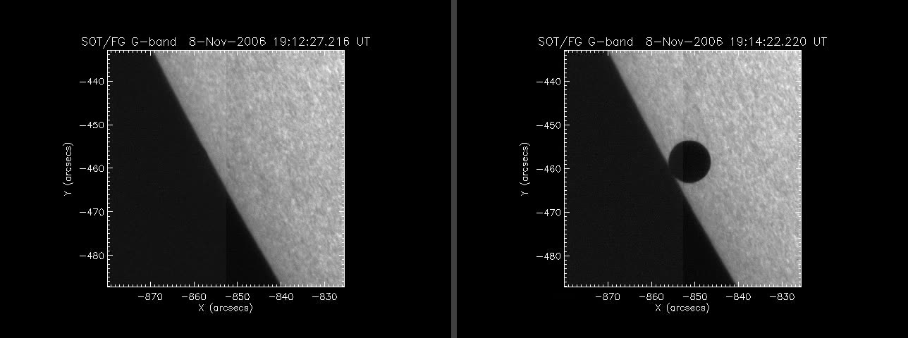

出の動画は [FG_GBM20061109000431_001204.mpg](https://hinode.nao.ac.jp/en/for-researchers/qlmovies/movie_sirius/2006/11/09/FG_GBM20061109000431_001204.mpg)（[その日の一覧](https://hinode.nao.ac.jp/en/for-researchers/qlmovies/movie_sirius/2006/11/09/hsc_ql20061109.html)）、左が第3接触（計算 00:08:00.3）の 1.8 秒後の 00:08:02.1、右が第4接触（計算 00:09:59.7）の 2.5 秒前の 00:09:57.1 のコマ（小さな欠けが残る）です。

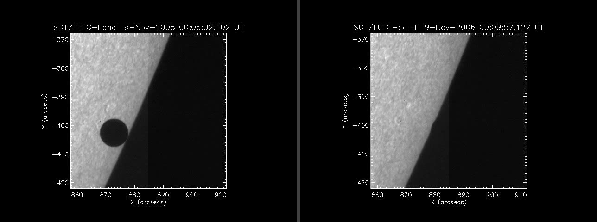

### A.2 2017〜2026 年の日食（1.2 節）

表の値（現象ごとの加重平均）のもとになった、各パスの露光の短い（または 1 本だけの）動画です。s はこの付録のために 2026-10-29 に同じ方法で測り直したパスごとの値で、表の値とは誤差の範囲（0.3 秒以内）で一致します。

**2017-08-21 最大 16:57:32 UT、食分 0.718** — [XRT_APM20170821061950_185419.mpg](https://hinode.nao.ac.jp/en/for-researchers/qlmovies/movie_sirius/2017/08/21/XRT_APM20170821061950_185419.mpg)（XRT Al poly、[その日の一覧](https://hinode.nao.ac.jp/en/for-researchers/qlmovies/movie_sirius/2017/08/21/hsc_ql20170821.html)）、16:57:29.27 UT のコマ、s = +1.58 ± 0.32 秒（30 コマ）

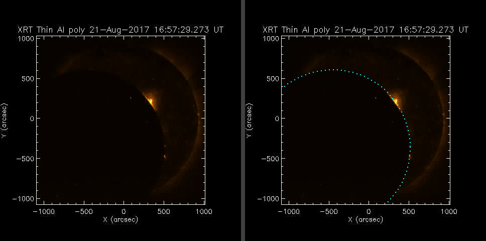

**2019-01-06 最大 00:20:46 UT、食分 0.537** — [XRT_APM20190106000012_005922.mpg](https://hinode.nao.ac.jp/en/for-researchers/qlmovies/movie_sirius/2019/01/06/XRT_APM20190106000012_005922.mpg)（XRT Al poly、[その日の一覧](https://hinode.nao.ac.jp/en/for-researchers/qlmovies/movie_sirius/2019/01/06/hsc_ql20190106.html)）、00:20:42.09 UT のコマ、s = +1.57 ± 0.77 秒（24 コマ）

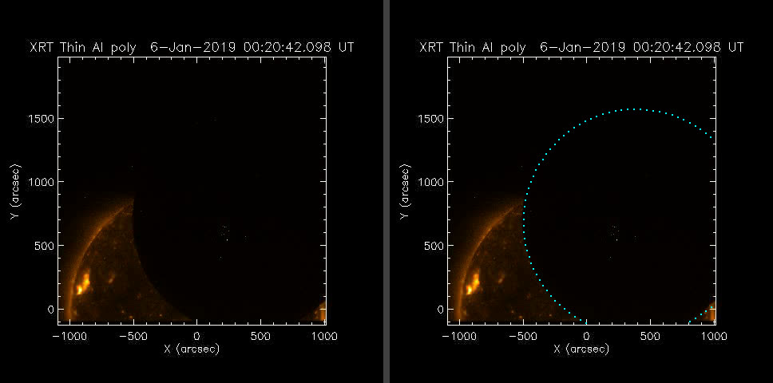

**2019-12-26 最大 03:44:16 UT、食分 0.682** — [XRT_APM20191226033017_035643.mpg](https://hinode.nao.ac.jp/en/for-researchers/qlmovies/movie_sirius/2019/12/26/XRT_APM20191226033017_035643.mpg)（XRT Al poly、[その日の一覧](https://hinode.nao.ac.jp/en/for-researchers/qlmovies/movie_sirius/2019/12/26/hsc_ql20191226.html)）、03:44:12.83 UT のコマ、s = +1.39 ± 0.73 秒（26 コマ）

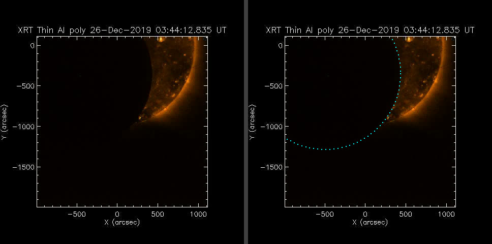

**2019-12-26 最大 06:29:41 UT、食分 0.411** — [XRT_APM20191226061510_064436.mpg](https://hinode.nao.ac.jp/en/for-researchers/qlmovies/movie_sirius/2019/12/26/XRT_APM20191226061510_064436.mpg)（XRT Al poly、[その日の一覧](https://hinode.nao.ac.jp/en/for-researchers/qlmovies/movie_sirius/2019/12/26/hsc_ql20191226.html)）、06:29:36.12 UT のコマ、s = −0.15 ± 1.09 秒（25 コマ）

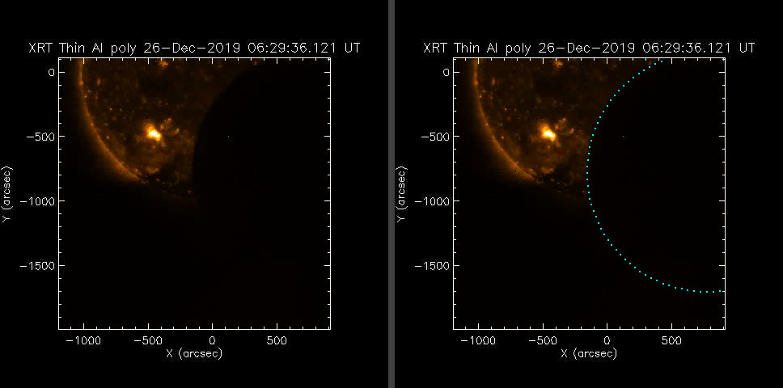

**2020-06-21 最大 09:16:03 UT、食分 0.469** — [XRT_APM20200621090843_092939.mpg](https://hinode.nao.ac.jp/en/for-researchers/qlmovies/movie_sirius/2020/06/21/XRT_APM20200621090843_092939.mpg)（XRT Al poly、[その日の一覧](https://hinode.nao.ac.jp/en/for-researchers/qlmovies/movie_sirius/2020/06/21/hsc_ql20200621.html)）、09:16:09.11 UT のコマ、s = +0.38 ± 0.17 秒（26 コマ）

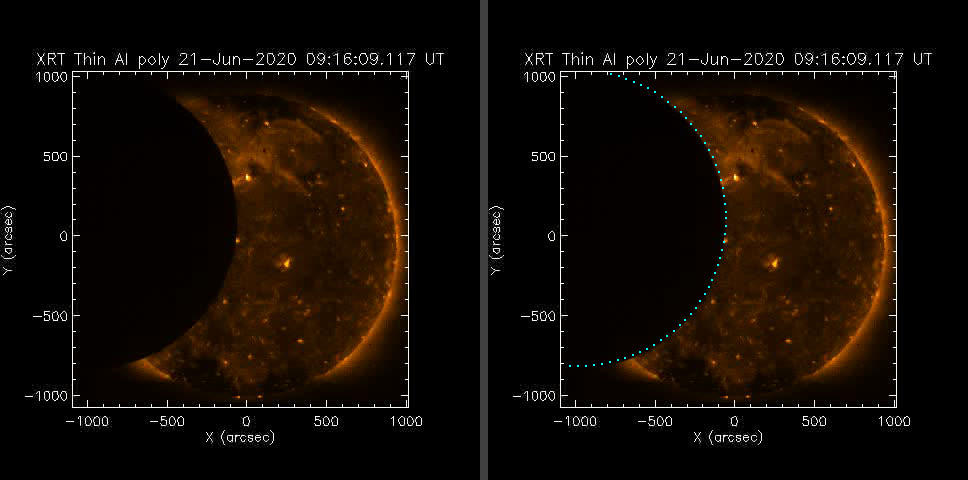

**2020-12-14 最大 15:00:49 UT、食分 0.379** — [XRT_APM20201214121211_152944.mpg](https://hinode.nao.ac.jp/en/for-researchers/qlmovies/movie_sirius/2020/12/14/XRT_APM20201214121211_152944.mpg)（XRT Al poly、[その日の一覧](https://hinode.nao.ac.jp/en/for-researchers/qlmovies/movie_sirius/2020/12/14/hsc_ql20201214.html)）、15:01:03.93 UT のコマ、s = −0.64 ± 1.17 秒（25 コマ）

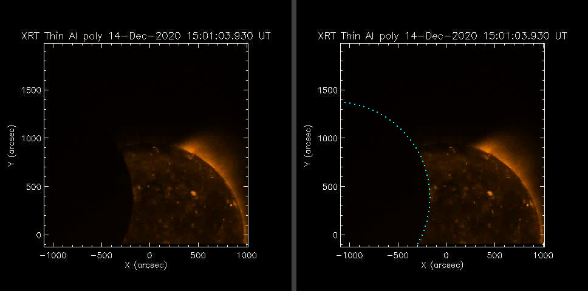

**2021-06-10 最大 11:23:43 UT、食分 0.941** — [XRT_APM20210610092259_114827.mpg](https://hinode.nao.ac.jp/en/for-researchers/qlmovies/movie_sirius/2021/06/10/XRT_APM20210610092259_114827.mpg)（XRT Al poly、[その日の一覧](https://hinode.nao.ac.jp/en/for-researchers/qlmovies/movie_sirius/2021/06/10/hsc_ql20210610.html)）、11:23:37.01 UT のコマ、s = +0.04 ± 0.29 秒（29 コマ）

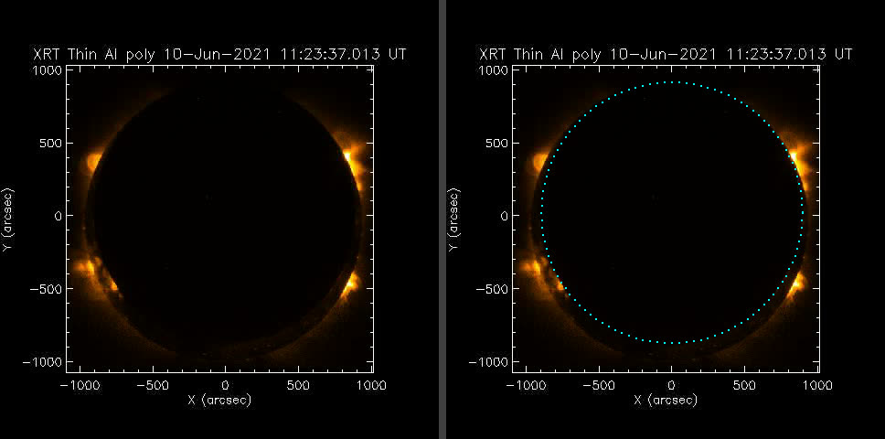

**2021-12-04 最大 07:40:28 UT、食分 0.801** — [XRT_APM20211204030331_075942.mpg](https://hinode.nao.ac.jp/en/for-researchers/qlmovies/movie_sirius/2021/12/04/XRT_APM20211204030331_075942.mpg)（XRT Al poly、[その日の一覧](https://hinode.nao.ac.jp/en/for-researchers/qlmovies/movie_sirius/2021/12/04/hsc_ql20211204.html)）、07:43:16.99 UT のコマ、s = −0.59 ± 0.33 秒（14 コマ）

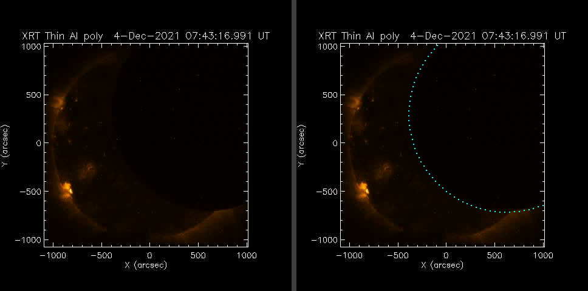

**2022-10-25 最大 09:06:51 UT、食分 0.291** — [XRT_APM20221025083311_092537.mpg](https://hinode.nao.ac.jp/en/for-researchers/qlmovies/movie_sirius/2022/10/25/XRT_APM20221025083311_092537.mpg)（XRT Al poly、[その日の一覧](https://hinode.nao.ac.jp/en/for-researchers/qlmovies/movie_sirius/2022/10/25/hsc_ql20221025.html)）、09:06:37.57 UT のコマ、s = −1.22 ± 0.96 秒（16 コマ）

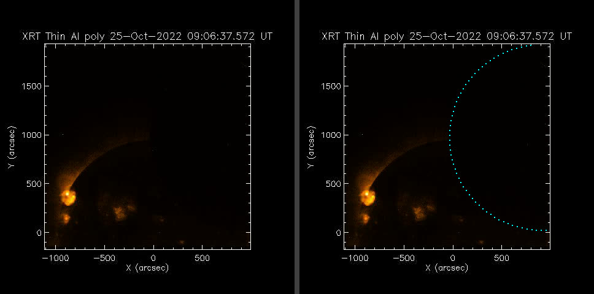

**2022-10-25 最大 10:35:51 UT、食分 0.985** — [XRT_APM20221025102555_174519.mpg](https://hinode.nao.ac.jp/en/for-researchers/qlmovies/movie_sirius/2022/10/25/XRT_APM20221025102555_174519.mpg)（XRT Al poly、[その日の一覧](https://hinode.nao.ac.jp/en/for-researchers/qlmovies/movie_sirius/2022/10/25/hsc_ql20221025.html)）、10:35:43.34 UT のコマ、s = +1.07 ± 0.16 秒（25 コマ）

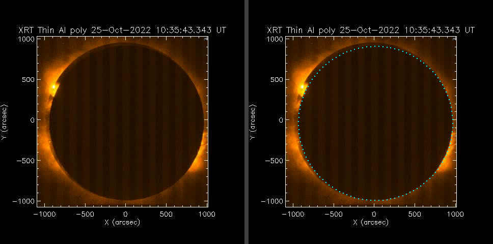

**2022-10-25 最大 12:03:13 UT、食分 0.751** — [XRT_APM20221025102555_174519.mpg](https://hinode.nao.ac.jp/en/for-researchers/qlmovies/movie_sirius/2022/10/25/XRT_APM20221025102555_174519.mpg)（XRT Al poly、[その日の一覧](https://hinode.nao.ac.jp/en/for-researchers/qlmovies/movie_sirius/2022/10/25/hsc_ql20221025.html)）、12:03:20.08 UT のコマ、s = +0.86 ± 0.15 秒（26 コマ）

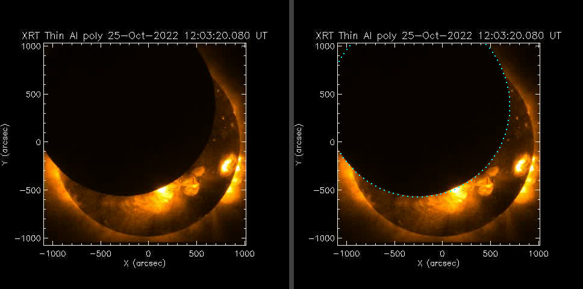

**2023-04-20 最大 05:48:50 UT、食分 0.708** — [XRT_ATM20230420054226_060146.mpg](https://hinode.nao.ac.jp/en/for-researchers/qlmovies/movie_sirius/2023/04/20/XRT_ATM20230420054226_060146.mpg)（XRT Al thick、[その日の一覧](https://hinode.nao.ac.jp/en/for-researchers/qlmovies/movie_sirius/2023/04/20/hsc_ql20230420.html)）、05:48:46.61 UT のコマ、s = +2.04 ± 0.73 秒（22 コマ）

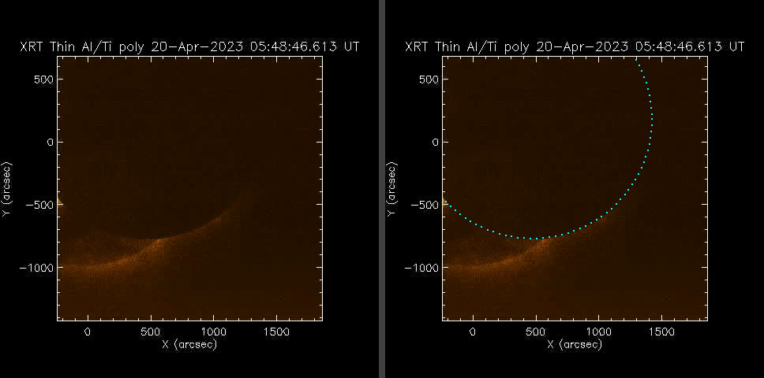

**2023-10-14 最大 15:31:17 UT、食分 0.549** — [XRT_APM20231014150313_155739.mpg](https://hinode.nao.ac.jp/en/for-researchers/qlmovies/movie_sirius/2023/10/14/XRT_APM20231014150313_155739.mpg)（XRT Al poly、[その日の一覧](https://hinode.nao.ac.jp/en/for-researchers/qlmovies/movie_sirius/2023/10/14/hsc_ql20231014.html)）、15:31:08.92 UT のコマ、s = −0.79 ± 0.49 秒（22 コマ）

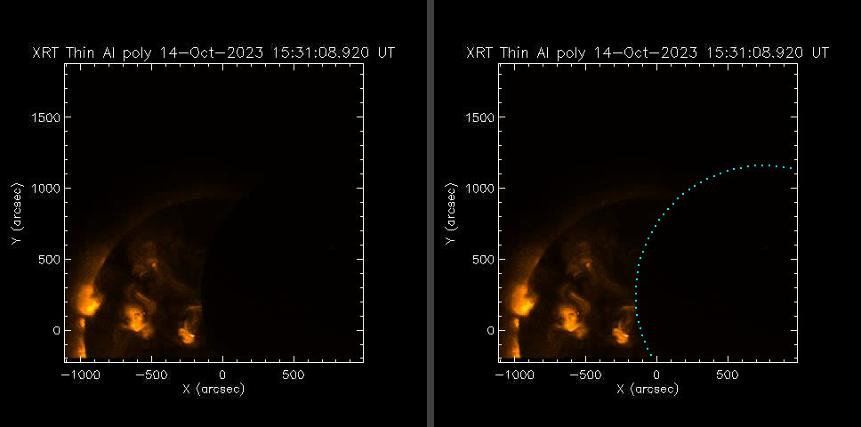

**2024-04-08 最大 17:00:05 UT、食分 0.489** — [XRT_APM20240408164110_171936.mpg](https://hinode.nao.ac.jp/en/for-researchers/qlmovies/movie_sirius/2024/04/08/XRT_APM20240408164110_171936.mpg)（XRT Al poly、[その日の一覧](https://hinode.nao.ac.jp/en/for-researchers/qlmovies/movie_sirius/2024/04/08/hsc_ql20240408.html)）、17:00:06.12 UT のコマ、s = +2.96 ± 1.11 秒（24 コマ）

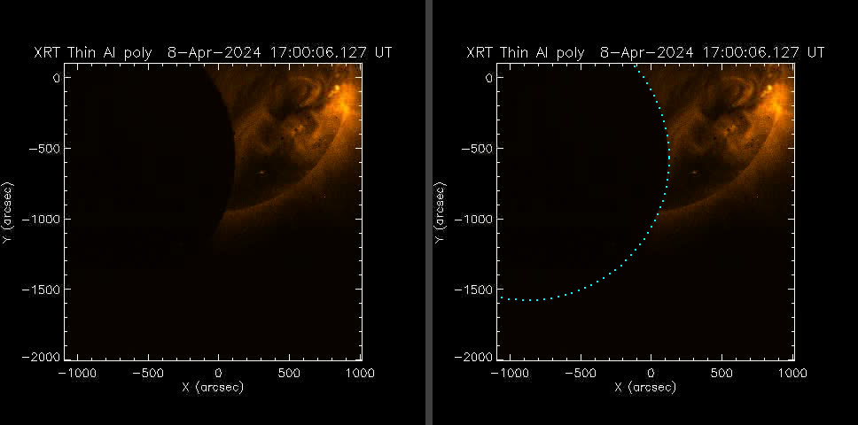

**2024-04-08 最大 19:42:22 UT、食分 0.622** — [XRT_APM20240408172346_195845.mpg](https://hinode.nao.ac.jp/en/for-researchers/qlmovies/movie_sirius/2024/04/08/XRT_APM20240408172346_195845.mpg)（XRT Al poly、[その日の一覧](https://hinode.nao.ac.jp/en/for-researchers/qlmovies/movie_sirius/2024/04/08/hsc_ql20240408.html)）、19:42:16.46 UT のコマ、s = −0.06 ± 0.31 秒（36 コマ）

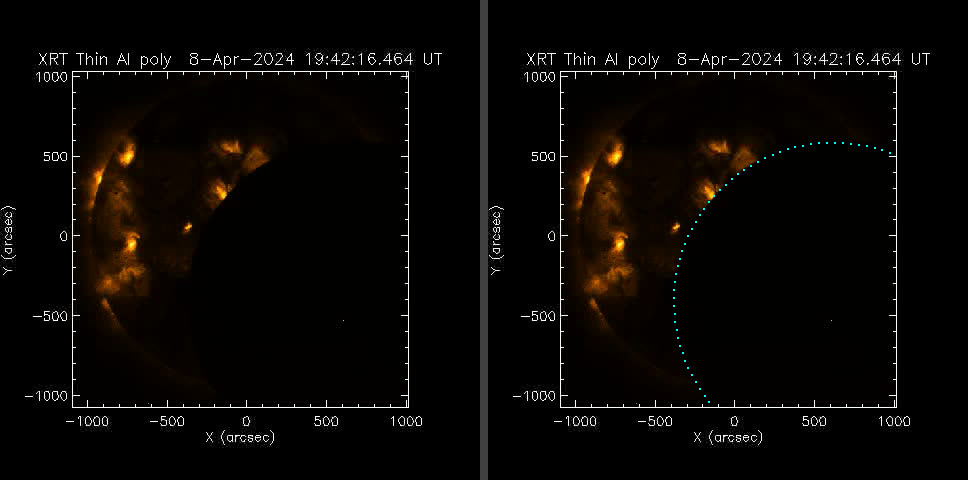

**2024-10-02 最大 16:35:12 UT、食分 0.850** — [XRT_APM20241002124345_180447.mpg](https://hinode.nao.ac.jp/en/for-researchers/qlmovies/movie_sirius/2024/10/02/XRT_APM20241002124345_180447.mpg)（XRT Al poly、[その日の一覧](https://hinode.nao.ac.jp/en/for-researchers/qlmovies/movie_sirius/2024/10/02/hsc_ql20241002.html)）、16:35:12.22 UT のコマ、s = −1.39 ± 0.22 秒（66 コマ）

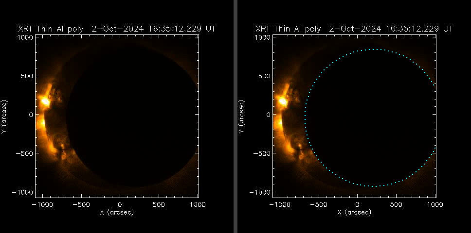

**2025-03-29 最大 09:25:12 UT、食分 0.586** — [XRT_APM20250329033322_175013.mpg](https://hinode.nao.ac.jp/en/for-researchers/qlmovies/movie_sirius/2025/03/29/XRT_APM20250329033322_175013.mpg)（XRT Al poly、[その日の一覧](https://hinode.nao.ac.jp/en/for-researchers/qlmovies/movie_sirius/2025/03/29/hsc_ql20250329.html)）、09:25:08.73 UT のコマ、s = +0.28 ± 0.25 秒（34 コマ）

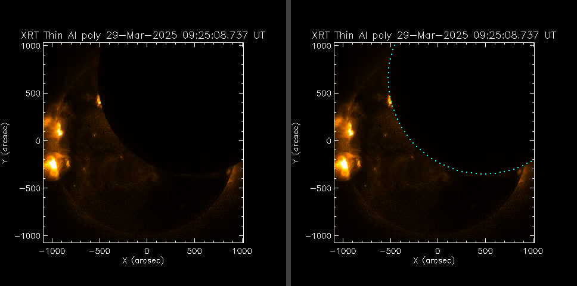

**2025-03-29 最大 10:52:26 UT、食分 0.962** — [XRT_APM20250329033322_175013.mpg](https://hinode.nao.ac.jp/en/for-researchers/qlmovies/movie_sirius/2025/03/29/XRT_APM20250329033322_175013.mpg)（XRT Al poly、[その日の一覧](https://hinode.nao.ac.jp/en/for-researchers/qlmovies/movie_sirius/2025/03/29/hsc_ql20250329.html)）、10:52:18.96 UT のコマ、s = +0.43 ± 0.20 秒（38 コマ）

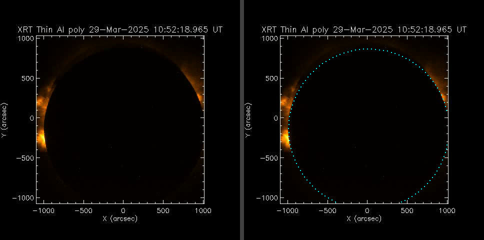

**2025-03-29 最大 12:20:01 UT、食分 0.478** — [XRT_APM20250329033322_175013.mpg](https://hinode.nao.ac.jp/en/for-researchers/qlmovies/movie_sirius/2025/03/29/XRT_APM20250329033322_175013.mpg)（XRT Al poly、[その日の一覧](https://hinode.nao.ac.jp/en/for-researchers/qlmovies/movie_sirius/2025/03/29/hsc_ql20250329.html)）、12:19:58.70 UT のコマ、s = +0.45 ± 0.19 秒（32 コマ）

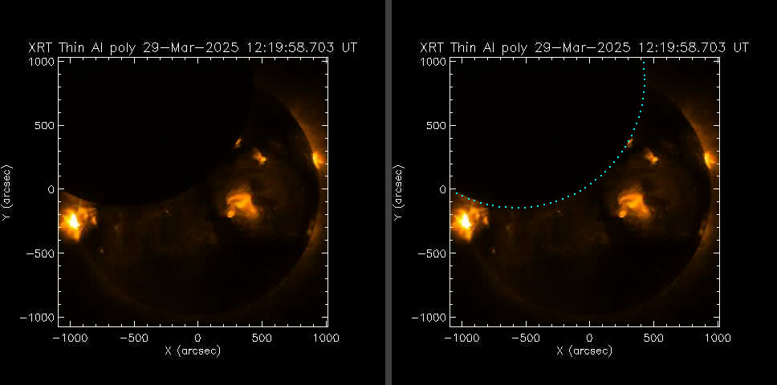

**2025-09-21 最大 17:47:04 UT、食分 0.350** — [XRT_APM20250921040327_213249.mpg](https://hinode.nao.ac.jp/en/for-researchers/qlmovies/movie_sirius/2025/09/21/XRT_APM20250921040327_213249.mpg)（XRT Al poly、[その日の一覧](https://hinode.nao.ac.jp/en/for-researchers/qlmovies/movie_sirius/2025/09/21/hsc_ql20250921.html)）、17:47:09.66 UT のコマ、s = +0.33 ± 0.40 秒（33 コマ）

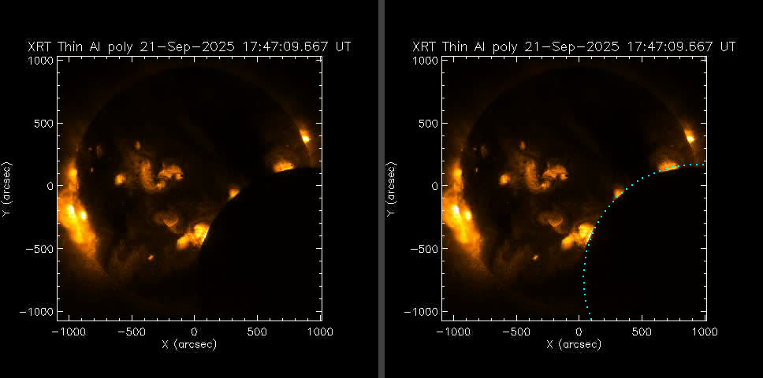

**2025-09-21 最大 19:36:02 UT、食分 0.901** — [XRT_APM20250921040327_213249.mpg](https://hinode.nao.ac.jp/en/for-researchers/qlmovies/movie_sirius/2025/09/21/XRT_APM20250921040327_213249.mpg)（XRT Al poly、[その日の一覧](https://hinode.nao.ac.jp/en/for-researchers/qlmovies/movie_sirius/2025/09/21/hsc_ql20250921.html)）、19:36:09.83 UT のコマ、s = −0.60 ± 0.24 秒（56 コマ）

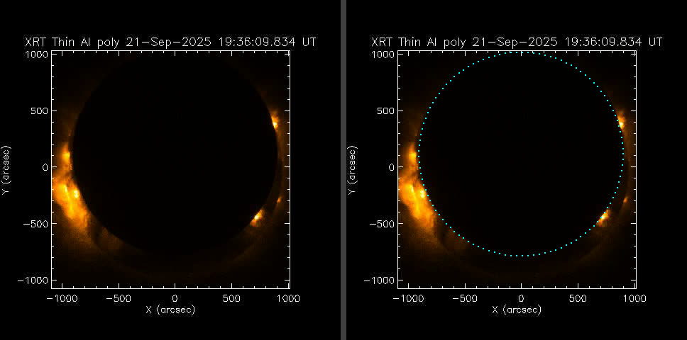

**2026-08-12 最大 17:53:49 UT、食分 0.728** — [XRT_APM20260812163330_183231.mpg](https://hinode.nao.ac.jp/en/for-researchers/qlmovies/movie_sirius/2026/08/12/XRT_APM20260812163330_183231.mpg)（XRT Al poly、[その日の一覧](https://hinode.nao.ac.jp/en/for-researchers/qlmovies/movie_sirius/2026/08/12/hsc_ql20260812.html)）、17:53:49.79 UT のコマ、s = +0.11 ± 0.56 秒（30 コマ）

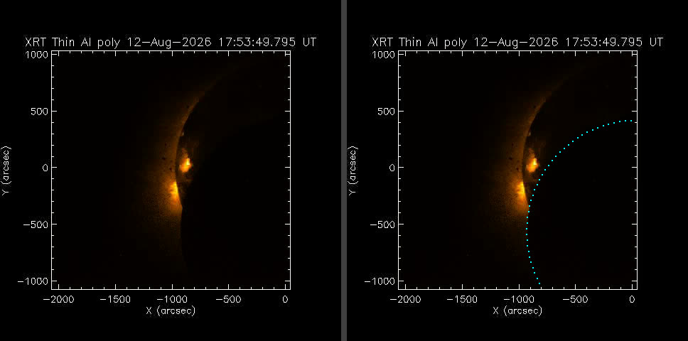

**2025-02-28 最大 00:49:32 UT（軌道上でだけ起きた食）** — [XRT_APM20250228005341_005736.mpg](https://hinode.nao.ac.jp/en/for-researchers/qlmovies/movie_sirius/2025/02/28/XRT_APM20250228005341_005736.mpg)（XRT Al poly、[その日の一覧](https://hinode.nao.ac.jp/en/for-researchers/qlmovies/movie_sirius/2025/02/28/hsc_ql20250228.html)）、00:53:41.41 UT のコマ。第4接触（00:52:14）の 1.5 分後、太陽面を出た月がコロナを背景に影絵として写っています

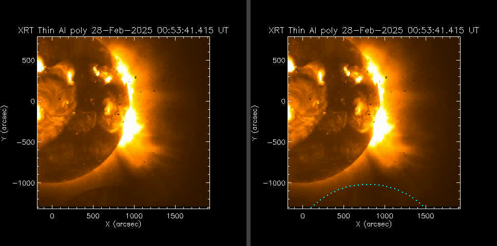

### A.3 2006〜2016 年の日食（1.3 節）

表に載せた全面の XRT 動画（27 パス・32 本）です。s は表と同じ測定のパスごとの値です。

**2007-02-17 最大 16:10:01 UT、食分 0.105** — [XRT_AMM20070217160100_162607.mpg](https://hinode.nao.ac.jp/en/for-researchers/qlmovies/movie_sirius/2007/02/17/XRT_AMM20070217160100_162607.mpg)（XRT Al mesh、[その日の一覧](https://hinode.nao.ac.jp/en/for-researchers/qlmovies/movie_sirius/2007/02/17/hsc_ql20070217.html)）、16:10:06.54 UT のコマ、s = +2.34 ± 1.28 秒（11 コマ）

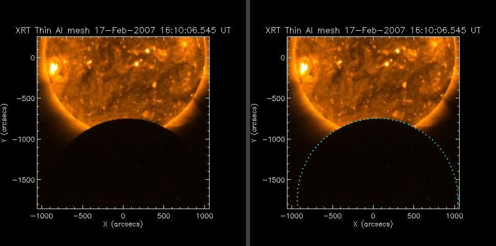

**2007-03-19 最大 02:55:43 UT、食分 1.018** — [XRT_APM20070319024759_030354.mpg](https://hinode.nao.ac.jp/en/for-researchers/qlmovies/movie_sirius/2007/03/19/XRT_APM20070319024759_030354.mpg)（XRT Al poly、[その日の一覧](https://hinode.nao.ac.jp/en/for-researchers/qlmovies/movie_sirius/2007/03/19/hsc_ql20070319.html)）、02:55:40.80 UT のコマ、s = +0.80 ± 0.12 秒（90 コマ）

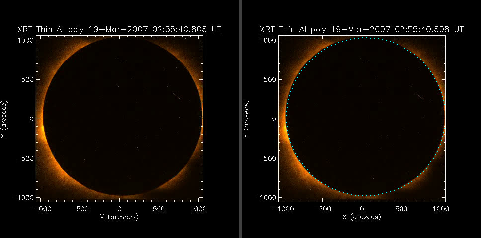

**2009-07-22 最大 00:58:03 UT、食分 0.734** — [XRT_TIM20090722004900_011313.mpg](https://hinode.nao.ac.jp/en/for-researchers/qlmovies/movie_sirius/2009/07/22/XRT_TIM20090722004900_011313.mpg)（XRT Ti poly、[その日の一覧](https://hinode.nao.ac.jp/en/for-researchers/qlmovies/movie_sirius/2009/07/22/hsc_ql20090722.html)）、00:58:04.34 UT のコマ、s = +2.19 ± 0.24 秒（63 コマ）

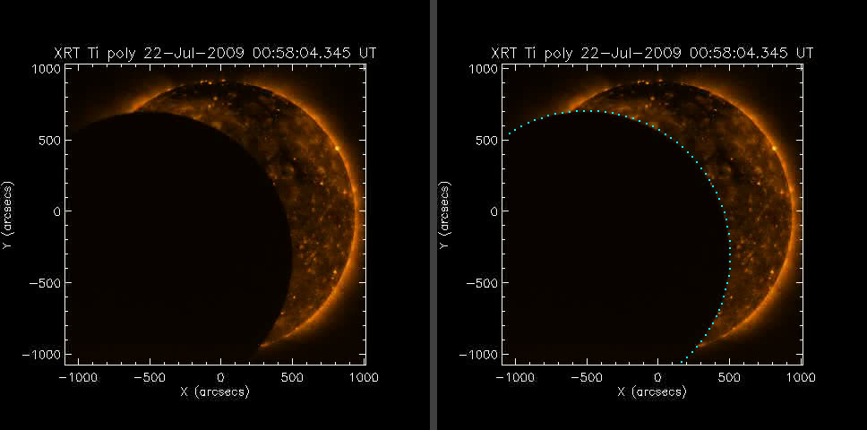

**2011-01-04 最大 07:48:05 UT、食分 0.743** — [XRT_TIM20110104073804_075739.mpg](https://hinode.nao.ac.jp/en/for-researchers/qlmovies/movie_sirius/2011/01/04/XRT_TIM20110104073804_075739.mpg)（XRT Ti poly、[その日の一覧](https://hinode.nao.ac.jp/en/for-researchers/qlmovies/movie_sirius/2011/01/04/hsc_ql20110104.html)）、07:47:59.44 UT のコマ、s = +2.47 ± 0.14 秒（34 コマ）

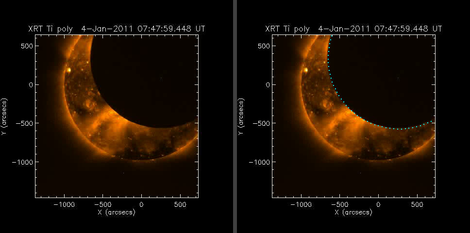

**2011-01-04 最大 09:16:07 UT、食分 0.939** — [XRT_TIM20110104090615_092549.mpg](https://hinode.nao.ac.jp/en/for-researchers/qlmovies/movie_sirius/2011/01/04/XRT_TIM20110104090615_092549.mpg)（XRT Ti poly、[その日の一覧](https://hinode.nao.ac.jp/en/for-researchers/qlmovies/movie_sirius/2011/01/04/hsc_ql20110104.html)）、09:16:09.69 UT のコマ、s = +2.58 ± 0.09 秒（42 コマ）

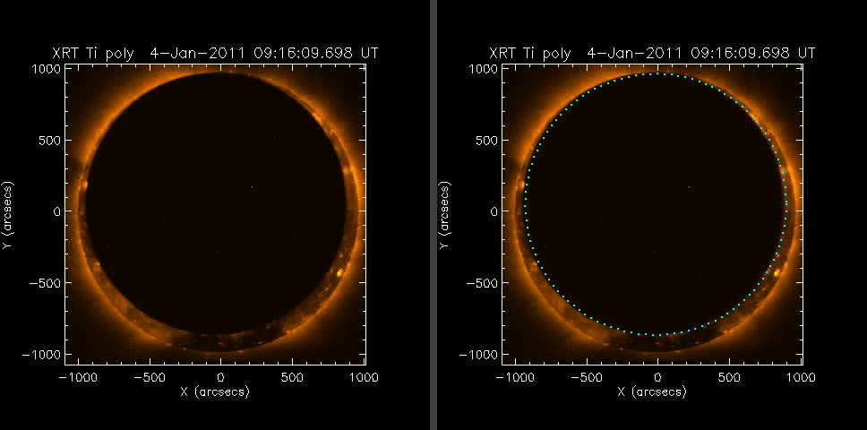

**2011-01-04 最大 10:45:35 UT、食分 0.324** — [XRT_TIM20110104104005_180111.mpg](https://hinode.nao.ac.jp/en/for-researchers/qlmovies/movie_sirius/2011/01/04/XRT_TIM20110104104005_180111.mpg)（XRT Ti poly、[その日の一覧](https://hinode.nao.ac.jp/en/for-researchers/qlmovies/movie_sirius/2011/01/04/hsc_ql20110104.html)）、10:44:59.46 UT のコマ、s = +2.48 ± 0.19 秒（28 コマ）

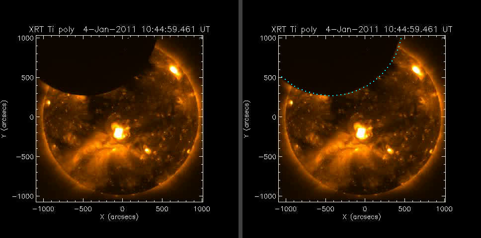

**2011-06-01 最大 20:41:51 UT、食分 0.508** — [XRT_TIM20110601203137_223344.mpg](https://hinode.nao.ac.jp/en/for-researchers/qlmovies/movie_sirius/2011/06/01/XRT_TIM20110601203137_223344.mpg)（XRT Ti poly、[その日の一覧](https://hinode.nao.ac.jp/en/for-researchers/qlmovies/movie_sirius/2011/06/01/hsc_ql20110601.html)）、20:40:54.06 UT のコマ、s = +1.51 ± 0.17 秒（33 コマ）

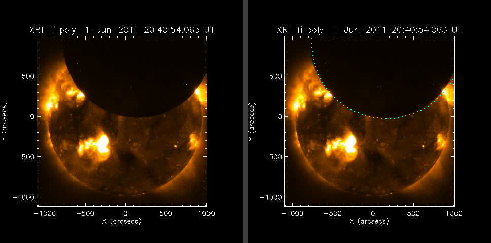

**2011-06-01 最大 22:11:06 UT、食分 0.361** — [XRT_TIM20110601203137_223344.mpg](https://hinode.nao.ac.jp/en/for-researchers/qlmovies/movie_sirius/2011/06/01/XRT_TIM20110601203137_223344.mpg)（XRT Ti poly、[その日の一覧](https://hinode.nao.ac.jp/en/for-researchers/qlmovies/movie_sirius/2011/06/01/hsc_ql20110601.html)）、22:10:51.83 UT のコマ、s = +0.77 ± 0.23 秒（28 コマ）

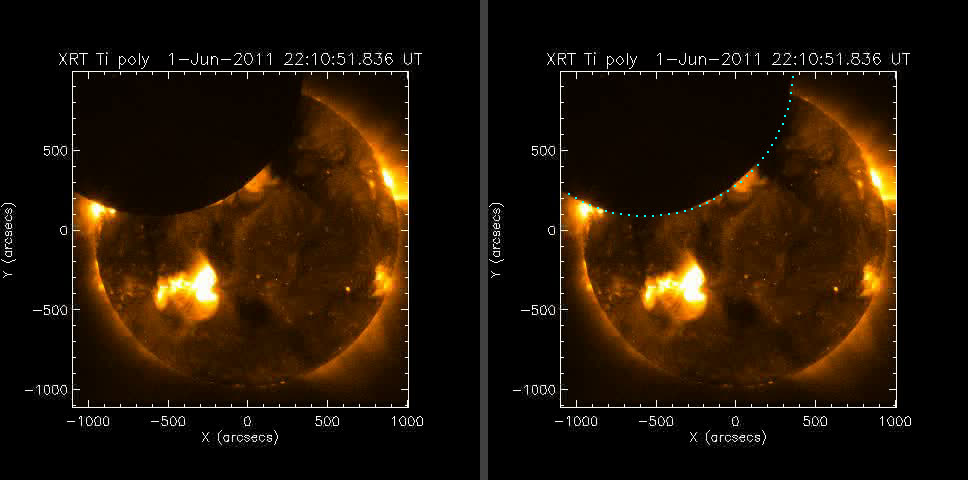

**2011-11-25 最大 04:15:52 UT、食分 0.095** — [XRT_TIM20111125041108_180838.mpg](https://hinode.nao.ac.jp/en/for-researchers/qlmovies/movie_sirius/2011/11/25/XRT_TIM20111125041108_180838.mpg)（XRT Ti poly、[その日の一覧](https://hinode.nao.ac.jp/en/for-researchers/qlmovies/movie_sirius/2011/11/25/hsc_ql20111125.html)）、04:15:04.96 UT のコマ、s = +1.60 ± 0.65 秒（16 コマ）

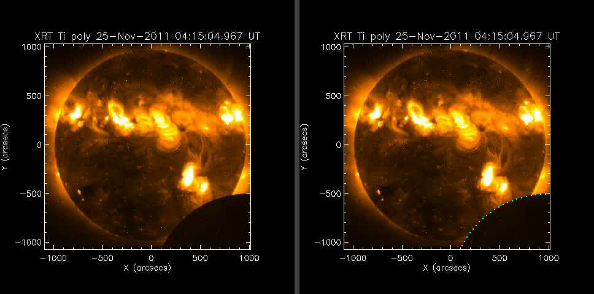

**2011-11-25 最大 06:05:05 UT、食分 0.968** — [XRT_TIM20111125041108_180838.mpg](https://hinode.nao.ac.jp/en/for-researchers/qlmovies/movie_sirius/2011/11/25/XRT_TIM20111125041108_180838.mpg)（XRT Ti poly、[その日の一覧](https://hinode.nao.ac.jp/en/for-researchers/qlmovies/movie_sirius/2011/11/25/hsc_ql20111125.html)）、06:05:04.14 UT のコマ、s = +0.80 ± 0.07 秒（50 コマ）

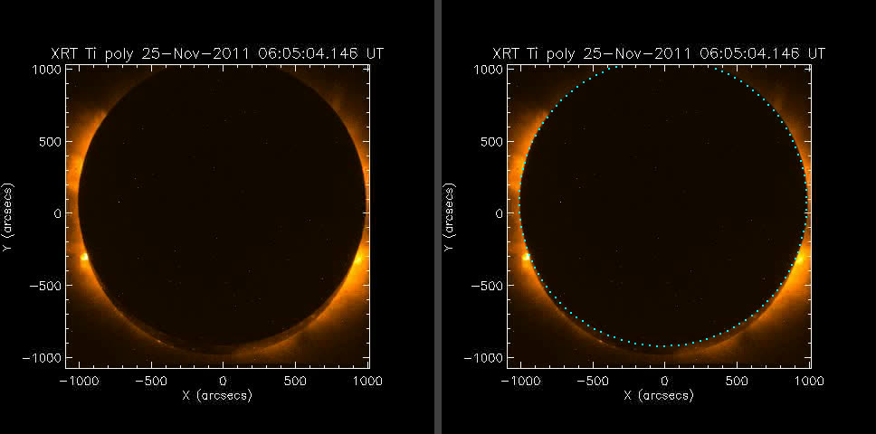

**2011-11-25 最大 07:56:29 UT、食分 0.418** — [XRT_TIM20111125041108_180838.mpg](https://hinode.nao.ac.jp/en/for-researchers/qlmovies/movie_sirius/2011/11/25/XRT_TIM20111125041108_180838.mpg)（XRT Ti poly、[その日の一覧](https://hinode.nao.ac.jp/en/for-researchers/qlmovies/movie_sirius/2011/11/25/hsc_ql20111125.html)）、07:55:56.84 UT のコマ、s = +0.84 ± 0.24 秒（31 コマ）

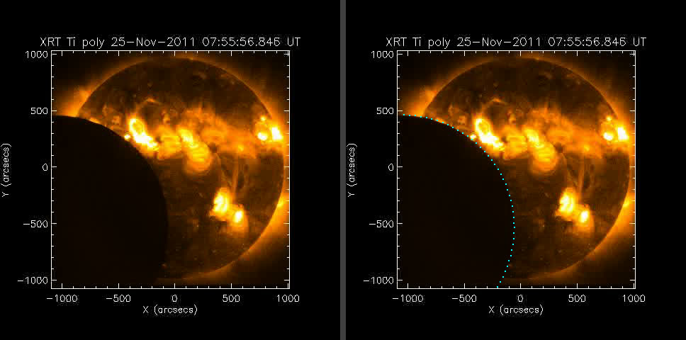

**2012-05-20 最大 21:41:37 UT、食分 0.795** — [XRT_TIM20120520060509_215306.mpg](https://hinode.nao.ac.jp/en/for-researchers/qlmovies/movie_sirius/2012/05/20/XRT_TIM20120520060509_215306.mpg)（XRT Ti poly、[その日の一覧](https://hinode.nao.ac.jp/en/for-researchers/qlmovies/movie_sirius/2012/05/20/hsc_ql20120520.html)）、21:41:05.97 UT のコマ、s = +1.41 ± 0.12 秒（48 コマ）

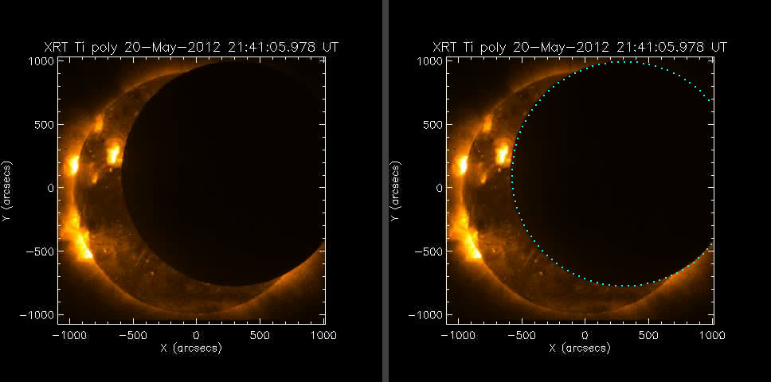

**2012-05-21 最大 00:32:17 UT、食分 0.300** — [XRT_TIM20120521002129_004606.mpg](https://hinode.nao.ac.jp/en/for-researchers/qlmovies/movie_sirius/2012/05/21/XRT_TIM20120521002129_004606.mpg)（XRT Ti poly、[その日の一覧](https://hinode.nao.ac.jp/en/for-researchers/qlmovies/movie_sirius/2012/05/21/hsc_ql20120521.html)）、00:32:05.84 UT のコマ、s = +1.05 ± 0.82 秒（32 コマ）

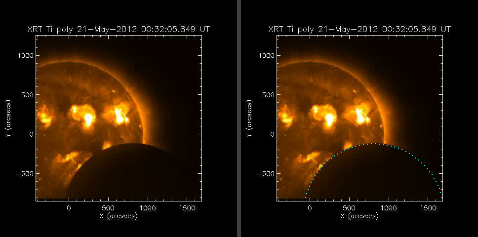

**2012-05-21 最大 02:01:21 UT、食分 0.709** — [XRT_TIM20120521014830_182237.mpg](https://hinode.nao.ac.jp/en/for-researchers/qlmovies/movie_sirius/2012/05/21/XRT_TIM20120521014830_182237.mpg)（XRT Ti poly、[その日の一覧](https://hinode.nao.ac.jp/en/for-researchers/qlmovies/movie_sirius/2012/05/21/hsc_ql20120521.html)）、02:01:06.60 UT のコマ、s = +1.21 ± 0.08 秒（43 コマ）

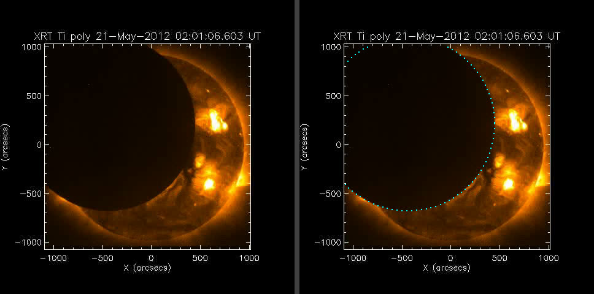

**2012-11-13 最大 20:24:29 UT、食分 1.012** — [XRT_APM20121113180133_235303.mpg](https://hinode.nao.ac.jp/en/for-researchers/qlmovies/movie_sirius/2012/11/13/XRT_APM20121113180133_235303.mpg)（XRT Al poly、[その日の一覧](https://hinode.nao.ac.jp/en/for-researchers/qlmovies/movie_sirius/2012/11/13/hsc_ql20121113.html)）、20:24:09.70 UT のコマ、s = +0.91 ± 0.14 秒（44 コマ）

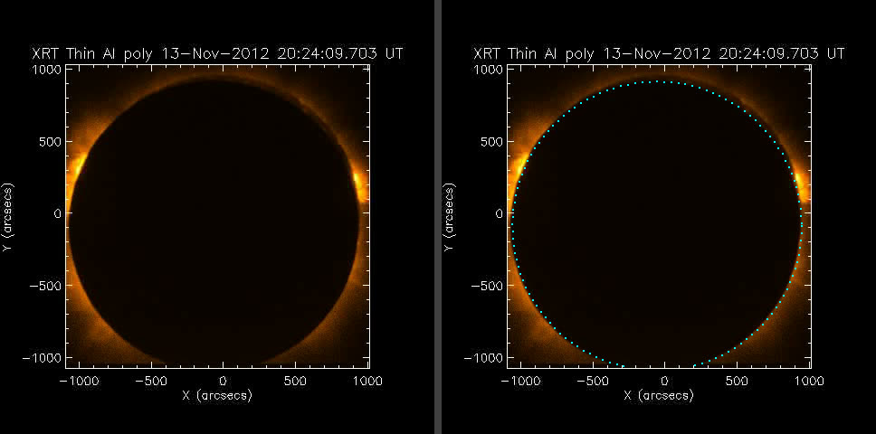

**2012-11-14 最大 00:20:35 UT、食分 0.627** — [XRT_APM20121114001202_002939.mpg](https://hinode.nao.ac.jp/en/for-researchers/qlmovies/movie_sirius/2012/11/14/XRT_APM20121114001202_002939.mpg)（XRT Al poly、[その日の一覧](https://hinode.nao.ac.jp/en/for-researchers/qlmovies/movie_sirius/2012/11/14/hsc_ql20121114.html)）、00:19:58.87 UT のコマ、s = +0.47 ± 0.16 秒（39 コマ）

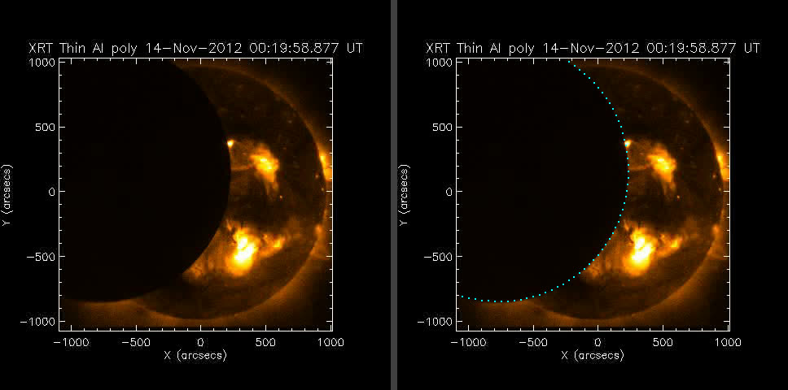

**2013-05-09 最大 21:50:52 UT、食分 0.472** — [XRT_AMM20130509213758_215127.mpg](https://hinode.nao.ac.jp/en/for-researchers/qlmovies/movie_sirius/2013/05/09/XRT_AMM20130509213758_215127.mpg)（XRT Al mesh、[その日の一覧](https://hinode.nao.ac.jp/en/for-researchers/qlmovies/movie_sirius/2013/05/09/hsc_ql20130509.html)）、21:49:56.55 UT のコマ、s = +0.45 ± 0.39 秒（14 コマ）

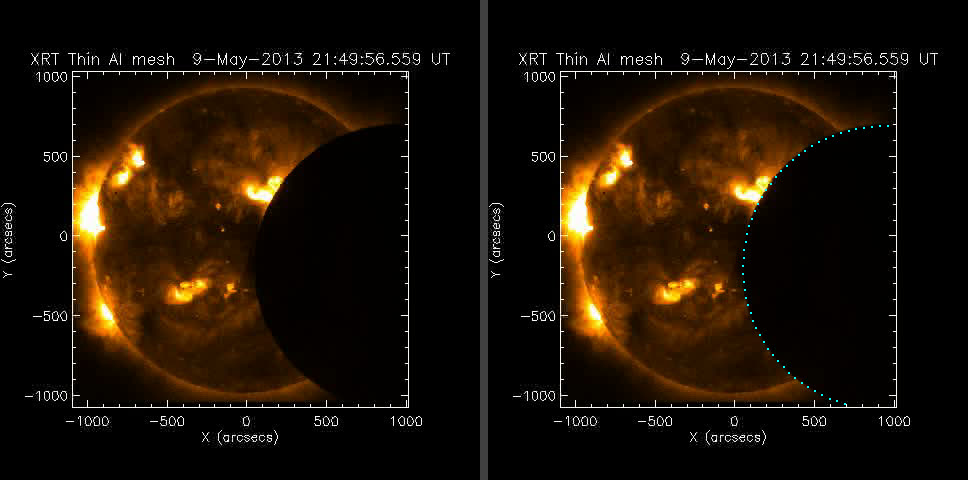

**2013-05-09 最大 21:50:52 UT、食分 0.472** — [XRT_TIM20130509213750_215119.mpg](https://hinode.nao.ac.jp/en/for-researchers/qlmovies/movie_sirius/2013/05/09/XRT_TIM20130509213750_215119.mpg)（XRT Ti poly、[その日の一覧](https://hinode.nao.ac.jp/en/for-researchers/qlmovies/movie_sirius/2013/05/09/hsc_ql20130509.html)）、21:49:48.78 UT のコマ、s = +1.27 ± 0.38 秒（14 コマ）

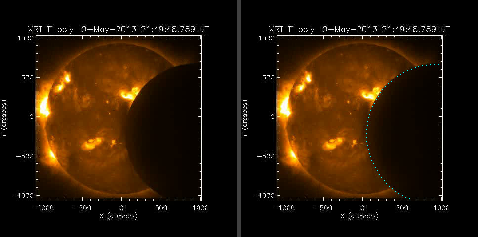

**2013-05-10 最大 01:48:51 UT、食分 0.372** — [XRT_AMM20130510013905_182335.mpg](https://hinode.nao.ac.jp/en/for-researchers/qlmovies/movie_sirius/2013/05/10/XRT_AMM20130510013905_182335.mpg)（XRT Al mesh、[その日の一覧](https://hinode.nao.ac.jp/en/for-researchers/qlmovies/movie_sirius/2013/05/10/hsc_ql20130510.html)）、01:48:04.77 UT のコマ、s = −0.01 ± 0.22 秒（55 コマ）

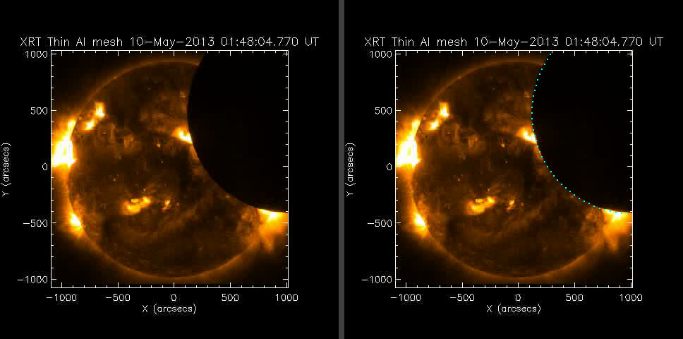

**2013-05-10 最大 01:48:51 UT、食分 0.372** — [XRT_TIM20130510013857_182407.mpg](https://hinode.nao.ac.jp/en/for-researchers/qlmovies/movie_sirius/2013/05/10/XRT_TIM20130510013857_182407.mpg)（XRT Ti poly、[その日の一覧](https://hinode.nao.ac.jp/en/for-researchers/qlmovies/movie_sirius/2013/05/10/hsc_ql20130510.html)）、01:47:56.76 UT のコマ、s = +0.63 ± 0.19 秒（54 コマ）

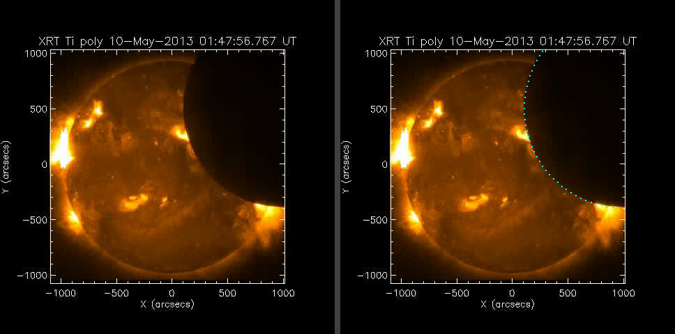

**2013-05-10 最大 03:28:13 UT、食分 0.121** — [XRT_AMM20130510013905_182335.mpg](https://hinode.nao.ac.jp/en/for-researchers/qlmovies/movie_sirius/2013/05/10/XRT_AMM20130510013905_182335.mpg)（XRT Al mesh、[その日の一覧](https://hinode.nao.ac.jp/en/for-researchers/qlmovies/movie_sirius/2013/05/10/hsc_ql20130510.html)）、03:28:02.73 UT のコマ、s = −1.48 ± 0.57 秒（13 コマ）

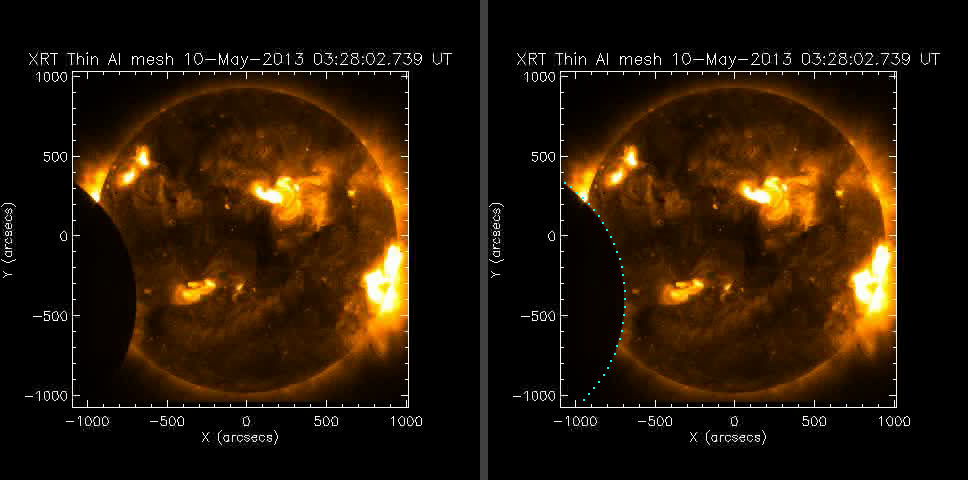

**2013-05-10 最大 03:28:13 UT、食分 0.121** — [XRT_TIM20130510013857_182407.mpg](https://hinode.nao.ac.jp/en/for-researchers/qlmovies/movie_sirius/2013/05/10/XRT_TIM20130510013857_182407.mpg)（XRT Ti poly、[その日の一覧](https://hinode.nao.ac.jp/en/for-researchers/qlmovies/movie_sirius/2013/05/10/hsc_ql20130510.html)）、03:27:54.79 UT のコマ、s = −0.46 ± 0.70 秒（12 コマ）

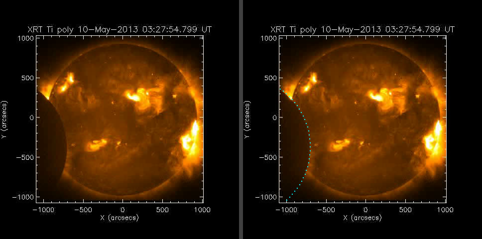

**2013-11-03 最大 11:29:47 UT、食分 0.429** — [XRT_AMM20131103060307_190806.mpg](https://hinode.nao.ac.jp/en/for-researchers/qlmovies/movie_sirius/2013/11/03/XRT_AMM20131103060307_190806.mpg)（XRT Al mesh、[その日の一覧](https://hinode.nao.ac.jp/en/for-researchers/qlmovies/movie_sirius/2013/11/03/hsc_ql20131103.html)）、11:28:58.25 UT のコマ、s = +0.13 ± 0.17 秒（37 コマ）

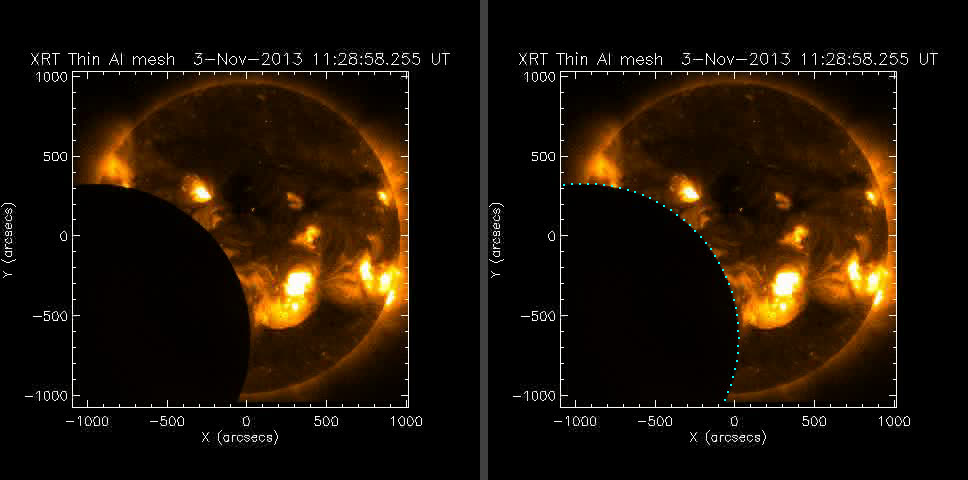

**2013-11-03 最大 11:29:47 UT、食分 0.429** — [XRT_TIM20131103060344_190844.mpg](https://hinode.nao.ac.jp/en/for-researchers/qlmovies/movie_sirius/2013/11/03/XRT_TIM20131103060344_190844.mpg)（XRT Ti poly、[その日の一覧](https://hinode.nao.ac.jp/en/for-researchers/qlmovies/movie_sirius/2013/11/03/hsc_ql20131103.html)）、11:28:50.25 UT のコマ、s = +0.73 ± 0.16 秒（37 コマ）

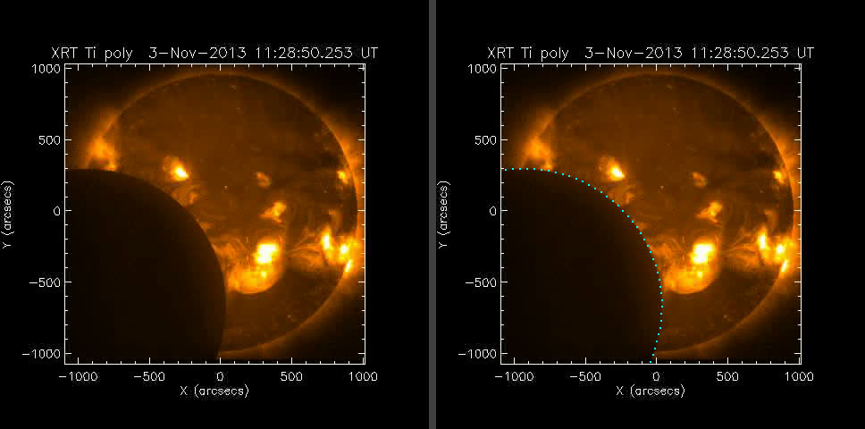

**2014-04-29 最大 07:27:44 UT、食分 0.699** — [XRT_TIM20140429060343_074328.mpg](https://hinode.nao.ac.jp/en/for-researchers/qlmovies/movie_sirius/2014/04/29/XRT_TIM20140429060343_074328.mpg)（XRT Ti poly、[その日の一覧](https://hinode.nao.ac.jp/en/for-researchers/qlmovies/movie_sirius/2014/04/29/hsc_ql20140429.html)）、07:26:56.47 UT のコマ、s = +1.07 ± 0.12 秒（26 コマ）

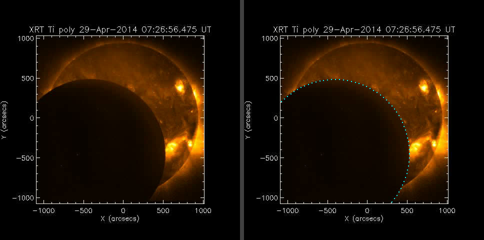

**2014-10-23 最大 21:53:25 UT、食分 0.957** — [XRT_APM20141023214500_220442.mpg](https://hinode.nao.ac.jp/en/for-researchers/qlmovies/movie_sirius/2014/10/23/XRT_APM20141023214500_220442.mpg)（XRT Al poly、[その日の一覧](https://hinode.nao.ac.jp/en/for-researchers/qlmovies/movie_sirius/2014/10/23/hsc_ql20141023.html)）、21:53:02.04 UT のコマ、s = +1.11 ± 0.19 秒（41 コマ）

**2014-10-23 最大 21:53:25 UT、食分 0.957** — [XRT_TIM20141023182245_220433.mpg](https://hinode.nao.ac.jp/en/for-researchers/qlmovies/movie_sirius/2014/10/23/XRT_TIM20141023182245_220433.mpg)（XRT Ti poly、[その日の一覧](https://hinode.nao.ac.jp/en/for-researchers/qlmovies/movie_sirius/2014/10/23/hsc_ql20141023.html)）、21:52:53.54 UT のコマ、s = +0.70 ± 0.24 秒（40 コマ）

**2015-03-20 最大 10:57:04 UT、食分 0.862** — [XRT_APM20150320085121_111120.mpg](https://hinode.nao.ac.jp/en/for-researchers/qlmovies/movie_sirius/2015/03/20/XRT_APM20150320085121_111120.mpg)（XRT Al poly、[その日の一覧](https://hinode.nao.ac.jp/en/for-researchers/qlmovies/movie_sirius/2015/03/20/hsc_ql20150320.html)）、10:56:56.79 UT のコマ、s = +0.80 ± 0.11 秒（38 コマ）

**2015-09-13 最大 05:55:49 UT、食分 0.752** — [XRT_BEM20150913054017_180659.mpg](https://hinode.nao.ac.jp/en/for-researchers/qlmovies/movie_sirius/2015/09/13/XRT_BEM20150913054017_180659.mpg)（XRT Be thin、[その日の一覧](https://hinode.nao.ac.jp/en/for-researchers/qlmovies/movie_sirius/2015/09/13/hsc_ql20150913.html)）、05:55:09.38 UT のコマ、s = +2.08 ± 0.25 秒（49 コマ）

**2015-09-13 最大 07:46:25 UT、食分 0.795** — [XRT_BEM20150913054017_180659.mpg](https://hinode.nao.ac.jp/en/for-researchers/qlmovies/movie_sirius/2015/09/13/XRT_BEM20150913054017_180659.mpg)（XRT Be thin、[その日の一覧](https://hinode.nao.ac.jp/en/for-researchers/qlmovies/movie_sirius/2015/09/13/hsc_ql20150913.html)）、07:46:07.58 UT のコマ、s = +3.55 ± 0.20 秒（49 コマ）

**2016-03-09 最大 00:08:11 UT、食分 0.986** — [XRT_BEM20160309000006_180416.mpg](https://hinode.nao.ac.jp/en/for-researchers/qlmovies/movie_sirius/2016/03/09/XRT_BEM20160309000006_180416.mpg)（XRT Be thin、[その日の一覧](https://hinode.nao.ac.jp/en/for-researchers/qlmovies/movie_sirius/2016/03/09/hsc_ql20160309.html)）、00:07:57.40 UT のコマ、s = +1.70 ± 0.16 秒（80 コマ）

**2016-03-09 最大 04:20:22 UT、食分 0.431** — [XRT_BEM20160309000006_180416.mpg](https://hinode.nao.ac.jp/en/for-researchers/qlmovies/movie_sirius/2016/03/09/XRT_BEM20160309000006_180416.mpg)（XRT Be thin、[その日の一覧](https://hinode.nao.ac.jp/en/for-researchers/qlmovies/movie_sirius/2016/03/09/hsc_ql20160309.html)）、04:20:00.88 UT のコマ、s = +1.56 ± 0.38 秒（62 コマ）

### A.4 太陽の一部しか写らない動画（1.3 節）

月の位置は座標軸（衛星の指向）で置いているため、計算の月の縁と実際の縁のずれには指向の誤差（数″〜25″）が含まれます。s は月が視野を覆う割合の時間変化を計算と合わせた時刻のずれ（目安）です。

**2007-03-19 01:28 頃のパス（1 回目のパス、SOT 約 220″ の視野）** — [FG_GBM20070319012408_013233.mpg](https://hinode.nao.ac.jp/en/for-researchers/qlmovies/movie_sirius/2007/03/19/FG_GBM20070319012408_013233.mpg)（SOT/FG G バンド、[その日の一覧](https://hinode.nao.ac.jp/en/for-researchers/qlmovies/movie_sirius/2007/03/19/hsc_ql20070319.html)）、01:29:13.53 UT のコマ、s ≒ −2.7 秒

**2007-03-19 02:55 頃のパス（2 回目（皆既）のパス、全面の XRT では +0.80 秒）** — [FG_GBM20070319014414_030159.mpg](https://hinode.nao.ac.jp/en/for-researchers/qlmovies/movie_sirius/2007/03/19/FG_GBM20070319014414_030159.mpg)（SOT/FG G バンド、[その日の一覧](https://hinode.nao.ac.jp/en/for-researchers/qlmovies/movie_sirius/2007/03/19/hsc_ql20070319.html)）、02:52:01.61 UT のコマ、s ≒ +2.4 秒

**2007-03-19 04:24 頃のパス（3 回目のパス）** — [FG_GBM20070319042137_043343.mpg](https://hinode.nao.ac.jp/en/for-researchers/qlmovies/movie_sirius/2007/03/19/FG_GBM20070319042137_043343.mpg)（SOT/FG G バンド、[その日の一覧](https://hinode.nao.ac.jp/en/for-researchers/qlmovies/movie_sirius/2007/03/19/hsc_ql20070319.html)）、04:24:11.97 UT のコマ、s ≒ +1.9 秒

**2008-02-07 03:25 頃のパス（2 回目のパス）** — [FG_BLM20080207031600_033431.mpg](https://hinode.nao.ac.jp/en/for-researchers/qlmovies/movie_sirius/2008/02/07/FG_BLM20080207031600_033431.mpg)（SOT/FG 青い連続光、[その日の一覧](https://hinode.nao.ac.jp/en/for-researchers/qlmovies/movie_sirius/2008/02/07/hsc_ql20080207.html)）、03:25:00.79 UT のコマ、s ≒ −4.4 秒

**2009-01-26 05:47 頃のパス（1 回目のパス、XRT 約 530″ の視野）** — [XRT_APM20090126053534_061156.mpg](https://hinode.nao.ac.jp/en/for-researchers/qlmovies/movie_sirius/2009/01/26/XRT_APM20090126053534_061156.mpg)（XRT Al poly、[その日の一覧](https://hinode.nao.ac.jp/en/for-researchers/qlmovies/movie_sirius/2009/01/26/hsc_ql20090126.html)）、05:47:32.01 UT のコマ、s ≒ +8.5 秒

**2009-07-22 05:06 頃のパス（2 回目のパス、XRT 約 790″ の視野）** — [XRT_APM20090722045846_055555.mpg](https://hinode.nao.ac.jp/en/for-researchers/qlmovies/movie_sirius/2009/07/22/XRT_APM20090722045846_055555.mpg)（XRT Al poly、[その日の一覧](https://hinode.nao.ac.jp/en/for-researchers/qlmovies/movie_sirius/2009/07/22/hsc_ql20090722.html)）、05:01:46.88 UT のコマ、s ≒ +4.3 秒

**2010-07-11 21:48 頃のパス（3 回目のパス）** — [FG_GBM20100711214509_215513.mpg](https://hinode.nao.ac.jp/en/for-researchers/qlmovies/movie_sirius/2010/07/11/FG_GBM20100711214509_215513.mpg)（SOT/FG G バンド、[その日の一覧](https://hinode.nao.ac.jp/en/for-researchers/qlmovies/movie_sirius/2010/07/11/hsc_ql20100711.html)）、21:47:39.60 UT のコマ、s ≒ −6.7 秒

**2015-03-20 08:03 頃のパス（1 回目のパス、SOT 約 110″ の視野）** — [FG_CAM20150320000040_235938.mpg](https://hinode.nao.ac.jp/en/for-researchers/qlmovies/movie_sirius/2015/03/20/FG_CAM20150320000040_235938.mpg)（SOT/FG Ca II H、[その日の一覧](https://hinode.nao.ac.jp/en/for-researchers/qlmovies/movie_sirius/2015/03/20/hsc_ql20150320.html)）、08:03:04.99 UT のコマ、s ≒ −6.0 秒

### A.5 2012-06-05/06 金星の太陽面通過（1.4 節）

[FG_GBM20120606001502_011840.mpg](https://hinode.nao.ac.jp/en/for-researchers/qlmovies/movie_sirius/2012/06/06/FG_GBM20120606001502_011840.mpg)（SOT/FG G バンド、[その日の一覧](https://hinode.nao.ac.jp/en/for-researchers/qlmovies/movie_sirius/2012/06/06/hsc_ql20120606.html)）の 01:01:02.6 UT のコマ（重ね描きなし）。金星の影の半径は、このような全周の写ったコマ 152 枚（G バンド・Ca II H・青い連続光、22:49〜04:19 UT）で測りました。

### A.6 広報画像（2 節）

広報画像はリポジトリに含めず、測った画像の URL を載せます（`tools/validate_hinode_images.py` が取得して測ります）。

| 現象 | 画像（撮影時刻 UT） |
|---|---|
| 2006-11-08 水星 | [19:13:02](https://hinode.nao.ac.jp/uploads/2016/06/24/mercury_sot_191302%202.png)、[19:14:41 と表記](https://hinode.nao.ac.jp/uploads/2016/06/24/mercury_sot_191441%202.png)、[00:08:02（第3接触）](https://hinode.nao.ac.jp/uploads/2016/06/24/SOT_M_t3_Red%202.png) |
| 2012-11-13 | [20:19](https://www.isas.jaxa.jp/home/solar/eclipse20121114/121113_Eclipse_2019UT.bmp)、[20:32](https://www.isas.jaxa.jp/home/solar/eclipse20121114/121113_Eclipse_2032UT.bmp) |
| 2014-10-23 | [21:48:33](https://www.isas.jaxa.jp/home/solar/eclipse20141023/ImgBW/20141023_20_XRTEclipse_214833.bmp)、[21:53:33](https://www.isas.jaxa.jp/home/solar/eclipse20141023/ImgBW/20141023_20_XRTEclipse_215333.bmp)、[21:58:13](https://www.isas.jaxa.jp/home/solar/eclipse20141023/ImgBW/20141023_20_XRTEclipse_215813.bmp) |
| 2016-03-09 | [00:03:24](https://www.isas.jaxa.jp/home/solar/eclipse20160309/ImgBW/XRTEclipse_20160309_000324.bmp)、[00:14:07](https://www.isas.jaxa.jp/home/solar/eclipse20160309/ImgBW/XRTEclipse_20160309_001407.bmp) |
| 2017-08-21 | [16:52:32](https://www.isas.jaxa.jp/home/solar/eclipse20170821/ImgBW/Eclipse_Start+2min_170821_165232_BW.bmp)、[16:57:32](https://www.isas.jaxa.jp/home/solar/eclipse20170821/ImgBW/Eclipse_Minimum_170821_165732_BW.bmp)、[17:03:02](https://www.isas.jaxa.jp/home/solar/eclipse20170821/ImgBW/Eclipse_End-2min_170821_170302_BW.bmp) |

QL 動画のコマ: 国立天文台ひので科学センター [Hinode QL Movies](https://hinode.nao.ac.jp/en/for-researchers/qlmovies/)。Hinode is a Japanese mission developed and launched by ISAS/JAXA, with NAOJ as domestic partner and NASA and STFC (UK) as international partners.
